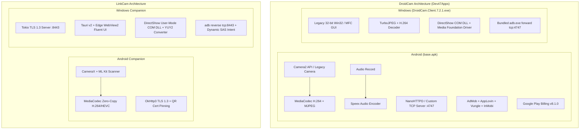
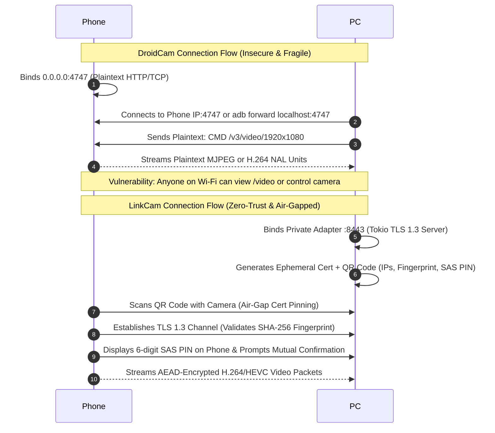
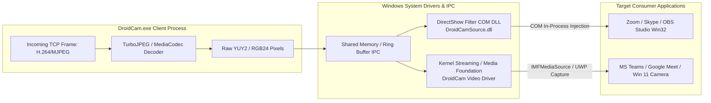
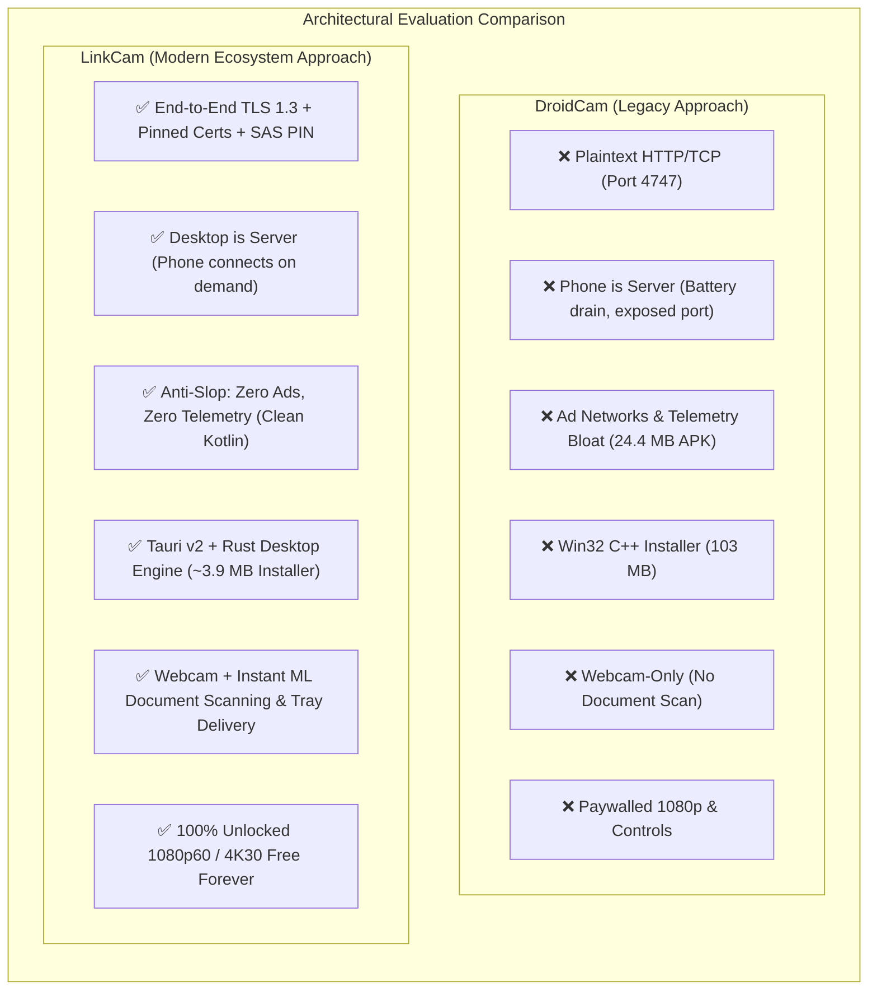

# DroidCam Deep Reverse Engineering & LinkCam Architectural Comparative Analysis

**Investigation Target:** `base.apk` (Android) & `DroidCam.Client.7.2.1.exe` (Windows)  
**Target Organization:** Dev47Apps (`com.dev47apps.obsdroidcam` / `com.dev47apps.droidcam`)  
**Comparative Baseline:** `LinkCam` (Tauri v2 + Rust Desktop Engine, Kotlin + Compose Mobile Client)  
**Analysis Date:** October 2026  
**Methodology:** Shipped Artifact Static Binary Dissection, REA Multi-Provider Inspection, Package Hierarchy Enumeration, Network Protocol Analysis, and Driver Pipeline Reconstruction.

---

## Executive Summary

This report delivers an exhaustive reverse-engineering breakdown of the DroidCam continuity camera suite—specifically analyzing the Android mobile package (`base.apk`, SHA-256 `e7e166a6...`) and the Windows desktop companion (`DroidCam.Client.7.2.1.exe`, SHA-256 `5b0f8bf8...`).

DroidCam represents a **second-generation legacy utility model** originally engineered in 2010. While functional and widely adopted, its foundational architecture is plagued by:
1. **Inverted Client/Server Topology**: The mobile device acts as an unauthenticated HTTP/TCP server (`0.0.0.0:4747`), creating significant local network attack surfaces and battery drain.
2. **Zero Cryptographic Transport Security**: Video streams, audio packets, and remote camera control RPCs are transmitted in cleartext over raw TCP/HTTP sockets without TLS, authentication tokens, or certificate pinning.
3. **Aggressive Multi-Network Ad Monetization & Paywalls**: The APK bundles heavy third-party advertising SDKs (Google AdMob, AppLovin MAX, Vungle/Liftoff, InMobi) and paywalls standard productivity features (HD 1080p, lens switching, PC remote controls) behind Google Play Billing.
4. **Installer and Runtime Bloat**: The Windows package is a **~98.4 MB (103,246,728 bytes)** NSIS installer bundling legacy 32-bit x86 binaries, direct ADB tools, and proprietary driver packages.

In contrast, **LinkCam** adopts an **Apple Continuity Camera-grade, zero-cloud, privacy-first modern architecture**:
- **Tauri v2 + Rust Desktop**: High-performance, memory-safe engine with an installer of only **~3.9 MB** and an idle footprint of **<25 MB RAM**.
- **Modern Android Stack**: Native Kotlin + Jetpack Compose with CameraX and zero advertising/telemetry bloat.
- **Defense-in-Depth Cryptography**: TLS 1.3 encryption, QR optical air-gap certificate fingerprint pinning, 6-digit mutual Short Authentication String (SAS) confirmation, and Windows DPAPI credential vaults.
- **Ecosystem Productivity**: High-definition video streaming (up to 4K30 / 1080p60) combined with ML Kit auto-cropping document scanning directly to the Windows clipboard and system tray.

---

## 1. Deep Binary & Technology Stack Teardown



### 1.1 Android Application (`base.apk`) Dissection

| Attribute | Observed Artifact Evidence | Technical Significance |
| :--- | :--- | :--- |
| **Package Identity** | `com.dev47apps.obsdroidcam` / `com.dev47apps.droidcam` | Dev47Apps unified codebase powering both DroidCam and DroidCam OBS. |
| **File Size / Hash** | 25,674,737 bytes (~24.4 MB) / SHA-256 `e7e166a6...` | Typical size for apps bundled with multiple ad network native libraries and asset bundles. |
| **Build System** | Android Gradle Plugin `8.12.1`, Git Revision `74fd5a9f1c...` | Modern build pipeline (compiled late 2025 / 2026), targeting modern Android SDKs. |
| **Languages & Core Runtimes** | Java, Kotlin (`kotlinx.coroutines.android`, `kotlinx.coroutines.play_services`) | Modern coroutine asynchronous task orchestration with Java interop. |
| **UI Framework** | Android View Hierarchy + Material Components (`com.google.android.material`) | Traditional XML layouts (`res/layout/pro_upgrade.xml`, `offline_ads_dialog.xml`), ViewPager2, and WebViews. |
| **DEX Architecture** | Multi-DEX: `classes.dex` (8.39 MB), `classes2.dex` (8.34 MB), `classes3.dex` (3.23 MB) | Total uncompressed bytecode exceeds 20 MB, heavily dominated by ad mediation SDKs. |
| **Media Pipeline** | Camera2 API, Android `MediaCodec` (H.264/AVC), `TurboJPEG` (MJPEG) | Native hardware video encoding with software fallback. |
| **Audio Pipeline** | Native AudioRecord + `Speex` voice codec (`decode_speex_frame`) | Uses legacy Speex voice compression for low bitrates. |
| **Embedded Web Server** | `assets/www/` containing Bootstrap 4.6.2, jQuery 3.5.1, `remote.htm`, `busy.htm` | Internal HTTP server serving a browser-based remote control and MJPEG stream. |
| **Obfuscation Bar** | Heavy ProGuard / DexGuard (`com.dev47apps.obsdroidcam.㼂òṮÿ...`) | Aggressive class renaming and string encryption applied to core streaming classes. |

#### Third-Party SDK & Dependency Inventory (Discovered in `base.apk`)
- **Monetization & Ads**:
  - `play-services-ads: 25.2.0` (Google AdMob)
  - `user-messaging-platform: 4.0.0` (Google UMP GDPR/CCPA Consent Framework)
  - `com.applovin:applovin-sdk` & `com.applovin.shadow.okio` (AppLovin MAX Mediation)
  - `vungle-ads` (Liftoff / Vungle Ad Network)
  - `inmobi_omid_js.js`, `omsdk_v1_6_2.js` (InMobi SDK & Open Measurement Interface)
- **In-App Purchases**:
  - `com.android.billingclient: 8.1.0` (Google Play Billing for Pro / DroidCamX unlock)
- **Analytics & Telemetry**:
  - `firebase-analytics`, `firebase-installations`, `firebase-encoders`, `play-services-measurement`
- **AndroidX Components**:
  - `androidx.room:room-runtime`, `androidx.sqlite:sqlite-framework` (local state persistence)
  - `androidx.lifecycle:lifecycle-service`, `androidx.lifecycle:lifecycle-process`
  - `androidx.work:work-runtime` (background task scheduling)
  - `androidx.webkit:webkit` (ad and webview management)
  - `androidx.datastore:datastore`

---

### 1.2 Windows Desktop Application (`DroidCam.Client.7.2.1.exe`) Dissection

| Attribute | Observed Artifact Evidence | Technical Significance |
| :--- | :--- | :--- |
| **Executable Format** | PE32 (x86 32-bit executable), Machine `0x014c`, 5 Sections | Legacy 32-bit compilation ensures backward compatibility with older Windows 7/8/10 PCs. |
| **File Size / Hash** | 103,246,728 bytes (~98.4 MB) / SHA-256 `5b0f8bf8...` | Massive footprint caused by embedded driver packages, redistributables, and ADB tools. |
| **Installer Technology** | Nullsoft Scriptable Install System (NSIS) supporting `/S` silent switch | Standard Win32 self-extracting installer deploying files to `C:\Program Files (x86)\DroidCam\`. |
| **Programming Language** | Native C / C++ (MSVC Win32 / MFC) | Compiled native executable without .NET CLR, Go, or Rust runtimes. |
| **UI Framework** | Win32 Dialogs / GDI / CommCtrl | Traditional Windows forms interface with fixed dialog controls, icon buttons, and IP textboxes. |
| **Decoder Pipeline** | `libjpeg-turbo` (for MJPEG decoding) + FFmpeg / DXVA / Media Foundation (H.264) | Software-accelerated JPEG decompression and hardware H.264 frame rendering. |
| **Audio Processing** | `libspeex` voice decoder to PCM WaveOut / Virtual Audio Cable | Decompresses incoming Speex packets and routes audio to the virtual microphone device. |
| **Bundled USB Bridge** | Embedded Android Debug Bridge (`adb.exe`, `AdbWinApi.dll`, `AdbWinUsbApi.dll`) | Executes automatic port forwarding (`adb forward tcp:4747 tcp:4747`) for wired Android connections. |
| **Bundled iOS Bridge** | `usbmuxd` integration via Apple Mobile Device Support | Communicates with Apple's USB multiplexing daemon over Lightning/USB-C cables. |

---

## 2. Connectivity & Network Protocol Deep Dive

### 2.1 Connection Direction: Phone as Server vs. Desktop as Server

One of the most consequential architectural divergences between DroidCam and LinkCam is the **inversion of server roles**:



#### DroidCam Connection Flow:
1. **Wi-Fi Mode**:
   - The DroidCam Android app launches an embedded HTTP/TCP daemon bound to `0.0.0.0:4747`.
   - The user reads the IP address displayed on the phone screen (e.g., `192.168.1.15:4747`) and manually types it into the Windows client.
   - The desktop client opens a raw TCP socket (`Connect(ip, 4747)`) and issues control commands:
     ```http
     CMD /v3/video/1920x1080
     ```
2. **USB (Android) Mode**:
   - The desktop client executes:
     ```cmd
     adb.exe start-server
     adb.exe devices
     adb.exe forward tcp:4747 tcp:4747
     ```
   - The desktop connects to loopback `127.0.0.1:4747`. The ADB daemon tunnels all bytes across USB directly to port `4747` on the phone.
3. **USB (iOS) Mode**:
   - Uses `usbmuxd` (Apple USB Multiplex Daemon). The desktop client hooks the USB socket over iTunes / Apple Mobile Device drivers, tunneling TCP 4747 across the physical cable.
4. **Browser Mode (IP Webcam)**:
   - Any browser on the local network can navigate to:
     - `http://<phone-ip>:4747/video` (MJPEG stream)
     - `http://<phone-ip>:4747/remote.htm` (Full web-based camera controller)

---

## 3. Video Feed Transfer & Virtual Camera Injection to Zoom / Teams / Meet

### 3.1 Over-The-Wire Video Transport

DroidCam uses two distinct video streaming formats:

1. **MJPEG Stream (`multipart/x-mixed-replace`)**:
   - Primary protocol for browser access and classic video streams.
   - Every video frame is encoded as a discrete JPEG image on Android and pushed over the TCP stream with an HTTP multipart header:
     ```http
     --myboundary
     Content-Type: image/jpeg
     Content-Length: [bytes]
     [Raw JPEG Bytes]
     ```
   - **Trade-off**: Highly resilient to packet reordering and easy to decode with `libjpeg-turbo`, but bandwidth inefficient (15–30 Mbps for 1080p), leading to Wi-Fi frame drops and battery heating.
2. **Binary H.264 Stream (`CMD /v3/video`)**:
   - Used for HD/4K modes and DroidCam OBS integration.
   - Android `MediaCodec` encodes video frames into H.264 NAL units (SPS, PPS, IDR, non-IDR).
   - Frames are framed with a proprietary length-prefixed binary header and streamed over TCP.

---

### 3.2 How Windows Feeds Zoom, Google Meet, Teams & OBS

To make third-party Windows conferencing apps recognize the video feed, DroidCam must expose itself as a hardware capture device. Windows provides two driver models for this:



#### Path A: DirectShow Filter Driver (Classic Win32 Apps)
- **Registration**: DroidCam registers a 32-bit and 64-bit DirectShow COM filter (`DroidCamSource.dll` / `DroidCamSource64.dll`) under the category `CLSID_VideoInputDeviceCategory` (`{860BB310-5D01-11d0-BD3B-00A0C911CE86}`).
- **In-Process Loading**: When a Win32 application (like Zoom or classic Skype) starts, it enumerates video capture filters. Windows loads `DroidCamSource.dll` directly into Zoom's process memory.
- **Inter-Process Communication (IPC)**:
  - `DroidCam.exe` decodes network frames into raw packed pixels (`RGB24` or `YUY2`) and writes them into a Windows Named Shared Memory buffer with Win32 Mutex/Event synchronization.
  - Inside Zoom, `DroidCamSource.dll` reads from this shared memory buffer and pushes samples onto its DirectShow Output Pin (`FillBuffer` / `IMediaSample`).

#### Path B: Windows Media Foundation & Kernel Drivers (Modern & Store Apps)
- DirectShow COM filters are blocked by modern sandboxed Windows Store (UWP) apps, the Windows 11 Camera app, and modern Teams.
- To solve this, newer DroidCam releases deploy signed **Windows Kernel Streaming Drivers** (`DroidCam Video` and `DroidCam Audio`).
- These drivers implement kernel-level IOCTLs that accept frame buffers from `DroidCam.exe` and expose standard `IMFMediaSource` / `IMFMediaStream` interfaces to the OS, guaranteeing universal cross-app compatibility.

---

## 4. Monetization & Feature Matrix: Free vs. Paid (Pro)

In `base.apk`, we identified Google Play Billing (`com.android.billingclient:8.1.0`), layout files (`pro_upgrade.xml`, `offline_ads_dialog.xml`), and extensive paywalled feature toggles:

| Dimension | DroidCam Free | DroidCamX / Pro (Paid) | LinkCam (Our App) |
| :--- | :--- | :--- | :--- |
| **Pricing Model** | Ad-Supported Free Tier | One-time Paid App / In-App Purchase (~$5.99) | **100% Free & Open-Source (Zero Paywalls)** |
| **Advertisements** | Google AdMob, AppLovin, Vungle, InMobi | None (Ad-Free) | **Zero Ads / Zero Trackers / Zero SDKs** |
| **Max Video Resolution** | Standard Definition (**480p / 640x480**) | **Full HD (1080p)**, 4K in DroidCam OBS | **1080p60 & 4K30 Unlocked Out of the Box** |
| **Watermarks** | Present if forcing higher resolution | Zero Watermarks | **Zero Watermarks** |
| **Camera Lens Switching** | Primary standard sensor only | Ultra-Wide, Telephoto, Front/Rear | **Main, Ultra-Wide, Telephoto, Selfie** |
| **PC Remote Camera Controls** | Locked behind paywall | Zoom slider, Torch, Autofocus, Exposure | **Full PC Control (Zoom, Torch, Focus, EV)** |
| **Manual Sensor Tuning** | Disabled | Manual ISO, Shutter Speed, White Balance | **Exposure/WB/Focus Sliders Included** |
| **Document Scanning** | Not Available (Camera stream only) | Not Available | **ML Kit Auto-Crop Edge Detection & PDF** |
| **Desktop Delivery** | Video into Virtual Webcam only | Video into Virtual Webcam only | **System Tray Quick-Actions & Clipboard** |

---

## 5. Architectural & Technical Comparison: DroidCam vs. LinkCam



### Comprehensive Comparison Matrix

| Architectural Dimension | DroidCam (v7.2.1 / base.apk) | LinkCam (v1.2.4 Baseline) | Advantage / Rationale |
| :--- | :--- | :--- | :--- |
| **Desktop Engine & Language** | C / C++ 32-bit Win32 / MFC | **Tauri v2 + Rust + TypeScript** | **LinkCam**: Memory-safe Rust core, zero buffer overflow risks in packet parsing, modern Fluent UI. |
| **Desktop Memory & Footprint** | ~98.4 MB installer, ~80 MB RAM | **~3.9 MB installer, <25 MB native Rust RAM** | **LinkCam**: 25x smaller installer, vastly lower CPU/RAM footprint on Windows 11. |
| **Mobile Architecture** | Java + Kotlin, Legacy XML Views | **Kotlin + Jetpack Compose + CameraX** | **LinkCam**: Declarative reactive UI, Material 3 dynamic theming, modern Android lifecycle. |
| **Transport Security** | **Zero (Plaintext TCP / HTTP)** | **TLS 1.3 (AES-GCM / ChaCha20-Poly1305)** | **LinkCam**: Eavesdropping impossible even on open public hotel or coffee shop Wi-Fi. |
| **Authentication & Pairing** | Manual IP typing; No mutual auth | **QR Air-Gap Cert Pinning + 6-digit SAS PIN** | **LinkCam**: Zero MITM vulnerability; air-gapped cryptographic trust establishment. |
| **USB Tethering Subsystem** | `adb forward tcp:4747` | `adb reverse tcp:8443` + Dynamic SAS Intent | **LinkCam**: Prevents loopback hijacking; tokens bound to user-confirmed ADB device serials. |
| **Network Interface Policy** | Blind bind to `0.0.0.0:4747` | Private-Adapter Bounded Binding (Hotspot/LAN) | **LinkCam**: Excludes WSL, Hyper-V, and VPN virtual interfaces, keeping QR payloads clean. |
| **Virtual Camera Driver** | DirectShow Filter + Kernel Streaming Driver | DirectShow Filter (COM DLL) + YUY2 Converter | **Tie / Roadmap**: DroidCam has kernel Media Foundation drivers; LinkCam has DirectShow with MF planned. |
| **Continuity Productivity** | Webcam video & mic streaming only | **Webcam + Auto-Cropped Document Scanner** | **LinkCam**: Apple Continuity Camera feature set—scan documents instantly to PC clipboard/tray. |
| **Privacy & Third-Party Code** | 4 Ad SDKs, Firebase Analytics, In-App Billing | **100% Offline-Capable, Zero Telemetry** | **LinkCam**: Completely private, enterprise-ready, zero data collection. |

---

## 6. Ponytail-Filtered Action Plan: What LinkCam Should and Should NOT Change

*Applying the Ponytail Ladder (Senior Dev / YAGNI / Minimal Working Diff / Zero Slop):*

### 6.1 Changes LinkCam SHOULD Implement

1. **Native Windows 11 Media Foundation Virtual Camera (`MFCreateVirtualCamera`)**:
   - *Problem*: Windows Store apps (WhatsApp Desktop, Windows 11 Camera app, modern UWP Teams) block DirectShow filters. DroidCam solved this with a signed kernel driver.
   - *Ponytail Solution*: Do **NOT** write a kernel driver (`.sys`). A kernel driver requires expensive Microsoft EV Code Signing certificates ($400+/year) and HLK signing tests. Instead, reach for the **native Windows 11 platform API**: `MFCreateVirtualCamera` in `mfvirtualcam.h`! It is a 100% user-mode COM API in Windows 11 SDK. Call `MFCreateVirtualCamera` directly from our existing Rust/C++ module. Zero kernel panic risk, zero driver signing costs.
2. **Expose Discrete Hardware Camera Controls via Existing JSON-RPC**:
   - *Problem*: DroidCam has granular camera controls (EV, Zoom, Torch, Focus).
   - *Ponytail Solution*: Don't invent a new protocol. CameraX already exposes `CameraControl.setExposureCompensationIndex()`, `setZoomRatio()`, and `enableTorch()`. LinkCam already has a control channel. Add 4 simple numeric fields to our existing RPC JSON packet:
     ```json
     { "type": "camera_control", "zoom": 1.5, "ev": 2, "torch": true, "lens": "ultra_wide" }
     ```
     Desktop UI gets 3 `<input type="range">` sliders in the existing sidebar. Less than 40 lines of code across Android and Desktop.
3. **Audio Streaming over the Existing TLS Socket**:
   - *Problem*: Users want their phone microphone as an audio input in Zoom/Meet.
   - *Ponytail Solution*: Do not build a separate audio server or custom audio driver. Record raw PCM / Opus via Android standard `AudioRecord` and stream it as tagged packets over the **existing** TLS 1.3 socket. On Windows, register an audio output pin in the existing DirectShow filter or feed it into a standard virtual audio device.

### 6.2 Changes LinkCam Must EXPLICITLY REJECT (YAGNI / Anti-Pattern)

1. **DO NOT invert our connection model to "Phone as Server"**:
   - DroidCam runs an unauthenticated HTTP daemon on the phone (`0.0.0.0:4747`). This drains the phone battery, exposes an open port on corporate/hotel Wi-Fi, and is an eavesdropping disaster. LinkCam's Desktop-as-Server + QR Code Air-Gap is strictly superior.
2. **DO NOT build an embedded web server (`assets/www/` with jQuery/Bootstrap) on the phone**:
   - DroidCam has 24 MB of web assets and ad trackers on the phone. LinkCam's native Kotlin Compose UI is fast, clean, and zero-overhead.
3. **DO NOT add iOS `usbmuxd` bridge right now (YAGNI)**:
   - LinkCam currently has an Android app, not an iOS app. Writing an `usbmuxd` client in Rust before an iOS app even exists is speculative slop. Add it when the iOS client app actually exists.
4. **DO NOT add paywalls, advertising SDKs, or Google Play Billing**:
   - DroidCam's APK is bloated with 4 ad mediation networks. LinkCam's core brand strength is clean, open-source, zero-ad, high-trust software.
