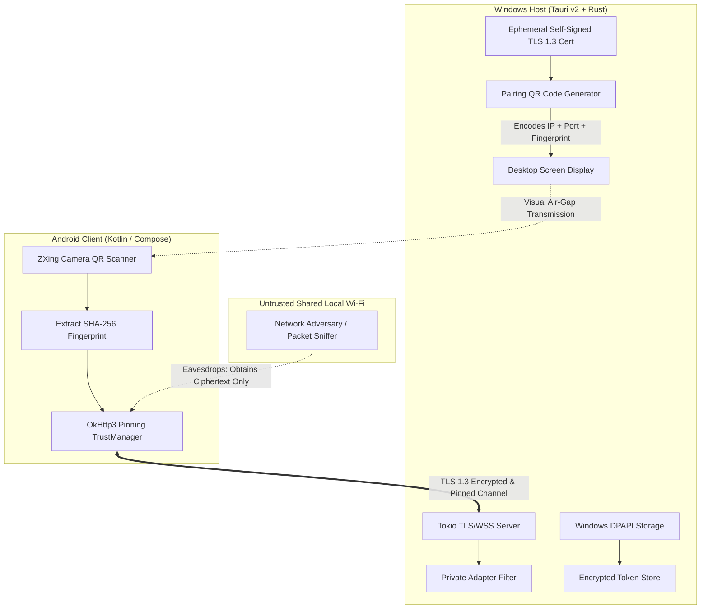
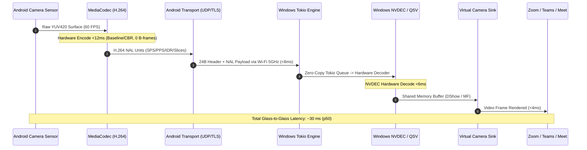
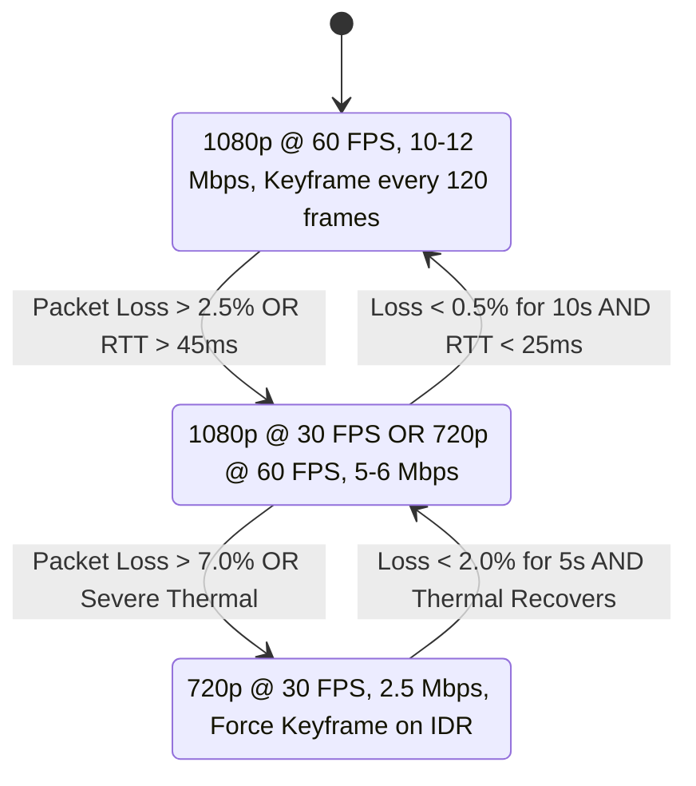
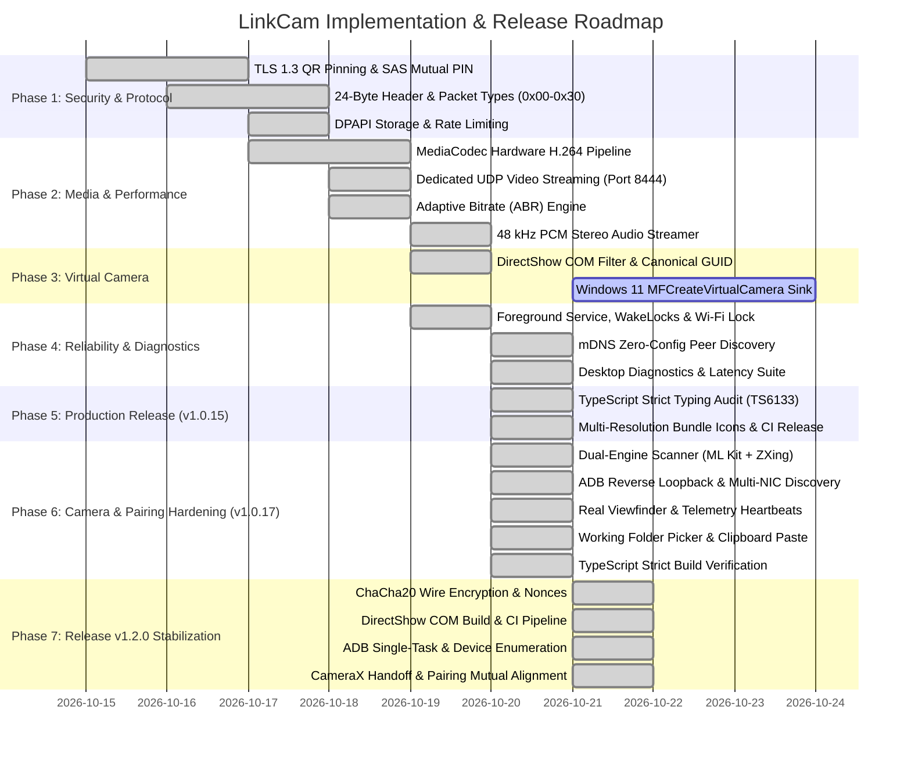

# LinkCam — Comprehensive Technical Architecture & System Specification

**Version:** 1.2.1 (Production Release Baseline)  
**Status:** Architecture & Implementation Baseline — Synchronized with v1.2.1 Release Codebase  
**Author:** LinkCam Engineering Team  
**Last Updated:** October 2026 (v1.2.1 DirectShow MFT Linker Fix, Live Studio Viewfinder Synchronization & Decoder Diagnostics)  
**Repository:** `Aniketkumar-01/LinkCam`  

---

## 1. Executive Summary & Vision

**LinkCam** is an open-source, enterprise-grade continuity camera and smart productivity ecosystem designed for Windows and Android. It seamlessly transforms an Android mobile device into a high-definition (1080p60 / 4K30), ultra-low-latency virtual webcam, remote camera controller, and high-resolution document scanner for Windows 10 & 11 PCs.

### Core Architectural Principles

1. **Zero External Cloud**: All audio, video, remote control RPCs, and captured documents flow strictly across local peer-to-peer transports (Direct Wi-Fi Hotspot, Local Area Network, or USB Reverse Tethering via ADB). No frames, telemetry, or user files ever leave the local network.
2. **Lean Desktop Footprint**: Unlike traditional desktop camera utilities that bundle a 150 MB Chromium runtime via Electron, LinkCam leverages **Tauri v2** and **Rust**. The Windows installer is **~3.9 MB**, the native Rust engine idles at **<25 MB RAM**, and total runtime footprint (including Microsoft Edge WebView2) remains under **~110 MB RAM**.
3. **Defense-in-Depth Security**: End-to-end encrypted streaming via TLS 1.3 with QR-pinned certificate fingerprints or Noise-IK handshakes, cryptographically derived Short Authentication String (SAS) mutual verification, Windows DPAPI token encryption, and private-adapter network binding.
4. **Dual-Path Virtual Camera Architecture**: 64-bit native user-mode COM DirectShow filter DLL baseline for Win32 applications (OBS, Discord, Zoom), with dynamic runtime capability probing and planned Phase 3.2 expansion to Windows 11 `MFCreateVirtualCamera` (`IMFMediaSource`) for sandboxed Windows Store and UWP camera apps.
5. **Measurable Performance**: Hardware-accelerated H.264/HEVC encoding via Android `MediaCodec`, zero-copy memory buffers, and dynamic Adaptive Bitrate (ABR) throttling.

---

## 2. Threat Model & Security Architecture



### 2.1 Threat Model (STRIDE Evaluation)

| Threat Category | Potential Attack Vector | LinkCam Architectural Mitigation |
| :--- | :--- | :--- |
| **Spoofing** | Rogue device on shared Wi-Fi attempts to masquerade as the user's phone or desktop. | Ephemeral TLS 1.3 certificate with SHA-256 fingerprint pinned through the physical camera-to-screen QR code scan. SAS / mutual PIN entry prevents MITM. |
| **Tampering** | Man-in-the-middle packet injection, truncation, or RPC parameter manipulation. | All control and media channels are protected by AEAD cipher suites (TLS_AES_128_GCM_SHA256 / ChaCha20-Poly1305). Chunks carry SHA-256 integrity digests. |
| **Repudiation** | Unauthenticated pairing requests spamming connection alerts. | Strict per-IP rate limiting (maximum 3 pairing handshakes per minute) with exponential backoff and ephemeral 120-second QR token expirations. |
| **Information Disclosure** | Packet sniffing of raw camera feeds, microphone audio, or scanned private documents on open hotel/office Wi-Fi. | Compulsory transport encryption for all packets. No plaintext fallback is permitted in production builds. |
| **Denial of Service** | Oversized packet headers claiming huge payload sizes (`u32::MAX`) allocating host RAM until Out-Of-Memory (OOM). | Hard payload limits: `MAX_FRAME_SIZE = 2 MB`, `MAX_CHUNK_SIZE = 10 MB`. Incoming packets exceeding caps trigger immediate socket termination. |
| **Elevation of Privilege** | Remote code execution via malformed buffer processing in DirectShow/Rust. | Memory-safe parsing in Rust, strict payload boundary checks, no kernel drivers, least-privilege Windows user-mode execution. |

### 2.2 Mutual Pairing & SAS Authentication Flow

Instead of a one-sided desktop confirmation click (which lacks mutual cryptographic verification), LinkCam uses a **Short Authentication String (SAS)** or **Mutual PIN Verification** model:

1. **Ephemeral Key Generation**: Upon companion startup, the Windows engine generates an ephemeral self-signed X.509 certificate and private key in memory (valid for 24 hours), alongside a cryptographically random 128-bit session token.
2. **Visual QR Air-Gap Exchange**: The desktop renders a QR code encoding:
   ```json
   {
     "port": 8443,
     "ips": ["192.168.1.105", "192.168.43.1"],
     "token": "9f8a2c1b4e...",
     "session_id": "sess_8f2a1...",
     "pin": "582 391",
     "fp": "SHA256:4a:3b:2c:1d:..."
   }
   ```
   (Both canonical keys `"auth_token"`, `"verification_pin"` and compact aliases `"p"`, `"ips"`, `"t"`, `"s"`, `"pin"`, `"token"` are supported bidirectionally by the desktop generator and Android parser in `PairingScreen.kt`).
3. **Certificate-Pinned Connection**: The Android client connects over TLS 1.3 and enforces that the server's certificate matches `fp`. This guarantees zero MITM interception over the network.
4. **SAS / PIN Derivation**: During the TLS handshake, both endpoints derive a 6-digit Short Authentication String (`SAS = HKDF-Expand(TLS-Exporter, "LinkCam-SAS", 6 digits)`) or display a random 6-digit PIN on the phone to be input on the desktop.
5. **Mutual User Confirmation**: The user confirms that the 6-digit code on the phone matches the desktop prompt before any audio/video feed is activated.
6. **Token Storage & Revocation**:
   - If the user selects "Trust this device", the resulting persistent mutual token is encrypted on Windows using **Windows DPAPI** (`CryptProtectData`) and written to `%LOCALAPPDATA%\LinkCam\trusted_devices.dat`.
   - On Android, the desktop trust credential is encrypted using the Android Keystore (`MasterKey.Builder(context).setKeyScheme(MasterKey.KeyScheme.AES256_GCM).build()`).
   - The desktop Settings UI provides a 1-click **Revoke All Devices** function that clears the DPAPI store and rotates the server keys immediately.

### 2.3 Network Adapter Binding, Virtual Interface Filtering & Firewall Policy

* **Bounded Port Binding**: Rather than binding blindly to `0.0.0.0:8443` (which exposes the service across public Wi-Fi profiles and VPN adapters like Tailscale/WireGuard), the companion binds to:
  1. Direct Wi-Fi mobile hotspot subnet adapter (e.g. `192.168.137.1` or `192.168.43.1`),
  2. Detected physical private local area network (LAN / Wi-Fi) adapter (`192.168.x.x` / `10.x.x.x` / `172.16.x.x`),
  3. Loopback (`127.0.0.1`) strictly for USB ADB reverse socket connections.
* **Multi-Adapter Discovery with Strict Virtual Adapter Filtering**:
  - Unrestricted multi-adapter discovery (`list_afinet_netifas`) inadvertently collects virtual network adapters (WSL, Hyper-V `vEthernet`, Docker bridges, Tailscale `100.x`, WireGuard tunnels, VMware, VirtualBox). Exposing these in the QR code bloats QR density, slows down optical scanning, and contradicts the private adapter isolation policy.
  - LinkCam enforces a strict adapter filter:
    - Case-insensitive blacklist on interface names: `vethernet`, `wsl`, `tailscale`, `wireguard`, `docker`, `hyper-v`, `virtual`, `tap`, `tun`, `host-only`, `vmware`, `zerotier`, `bluetooth`.
    - IP validation: strictly RFC 1918 IPv4 private addresses or Windows Mobile Hotspot default subnet (`192.168.137.0/24`). Link-local (`169.254.x.x`), multicast, and loopback are excluded from the QR payload.
    - Prioritization: Hotspot subnet is placed first, followed by primary physical Wi-Fi/Ethernet.
    - QR Payload Capping: The candidate IP list is strictly capped at **2–3 addresses**, ensuring the QR code remains low-density, high-contrast, and instantly decodable.
    - Dynamic Topology Re-binding: When Windows network events occur (e.g., Wi-Fi reconnection or Mobile Hotspot toggled), LinkCam re-enumerates adapters and refreshes the pairing payload.
* **Firewall Profile Enforcement**: On installation, the companion checks Windows Firewall configuration via `INetFwPolicy2` to restrict inbound connections on port 8443 strictly to the **Private Network Profile** (`NET_FW_PROFILE2_PRIVATE`), preventing exposure on public networks.

### 2.4 ADB Reverse USB Tethering Subsystem: Security, Transport & Lifecycle

LinkCam supports plug-and-play wired USB operation utilizing the Android Debug Bridge (ADB) reverse socket protocol:

* **Elimination of Static Loopback Auth Hole & Intent Fingerprint Pinning**:
  - *Threat Analysis*: Loopback traffic proves only that the connection originates from the same PC (`peer_addr.ip().is_loopback()`); it does **not** prove that the traffic originates from the user's phone. Accepting a hardcoded token (such as `lnk_usb`) allows any unprivileged local process, rogue app, second logged-in user, or RDP session to silently pair with port 8443, bypass Short Authentication String (SAS) confirmation, and inject arbitrary video into the virtual camera. Furthermore, connecting without TLS certificate pinning over loopback leaves the client vulnerable to rogue local processes impersonating the companion.
  - *Architectural Fix*: Static loopback tokens are completely eliminated. For USB mode:
    1. The desktop companion generates an ephemeral, cryptographically random, one-time USB pairing token per session (valid for 120 seconds).
    2. Because an incoming TCP socket carries no ADB device serial, the companion enforces USB authorization at token issuance: **tokens and reverse port forwards are only issued to ADB device serials that have been explicitly authorized by the user**.
    3. The token, session ID, and companion TLS certificate SHA-256 fingerprint (`cert_fp`) are pushed directly to the Android app over ADB using an explicit single-top intent:
       ```powershell
       adb -s <serial> shell am start -n com.linkcam.app/.ui.MainActivity -f 0x20000000 --es usb_token <token> --es session_id <session> --ei port 8443 --es cert_fp <fingerprint>
       ```
       (Combined with `android:launchMode="singleTask"` in `AndroidManifest.xml`, this ensures pushed tokens route directly to `onNewIntent` on the active instance without creating duplicate activities or colliding with active camera handles).
    4. The Android client extracts `cert_fp` and pins the TLS server certificate fingerprint during the loopback TLS handshake, preventing any local machine process from spoofing the desktop service.
    5. The desktop companion presents a one-time **"Trust this USB device?"** authorization prompt bound to the ADB device serial number and its device-held public key (persisted in Windows DPAPI credential store). Loopback connection attempts without an active, validated dynamic token are rejected.
    6. The loopback listener / `adb reverse` tunnel is activated strictly during an active USB session and is un-forwarded (`adb reverse --remove tcp:8443`) when the session ends.
    7. Alternatively, users pairing manually over USB must enter the 6-digit mutual SAS verification PIN displayed on the desktop companion screen.
* **Transport Protocol & The ADB Reverse UDP Limitation**:
  - *Protocol Limitation*: `adb reverse` forwards **TCP sockets only**. Command `adb reverse tcp:8444 tcp:8444` forwards TCP port 8444, meaning the companion's low-latency UDP datagram video listener on port 8444 is **completely unreachable over ADB reverse**.
  - *TCP-Framed USB Video Pipeline*: Over USB, all video frames are transmitted over the multiplexed TCP stream on port 8443 using the standard 24-byte protocol packet header (`PacketType::VideoFrame` = `0x01`). Port 8444 (UDP) is reserved strictly for Wi-Fi and direct hotspot network streaming.
  - *Latency Realities*: "Zero-latency" is an overclaim. Over USB 2.0/3.0, physical bus polling intervals, Android `MediaCodec` hardware encode (~10–14ms), and Windows frame sink rendering yield a realistic, measured end-to-end latency of **15–30 ms**, with zero Wi-Fi packet drop.
* **USB Subsystem Operational Lifecycle & Licensing**:
  - **Prerequisites**: The user must enable Developer Options on Android and toggle **USB Debugging** ON.
  - **System ADB Precedence & Daemon Preservation**: To avoid killing an active background ADB server daemon running under Android Studio or developer workflows due to protocol/version mismatch, LinkCam checks system `PATH` (`adb version`) first. It falls back to the bundled binary in `%LOCALAPPDATA%\LinkCam\platform-tools\` only when no system binary is detected.
  - **Platform-Tools Licensing Compliance**: Binaries of Android SDK Platform-Tools are redistributed under the terms of the Google Android SDK License Agreement, while the source is Apache 2.0. The desktop installer provides transparent attribution and license terms, supporting dynamic fetching or user-directed installation where appropriate.
  - **Device Authorization Prompt**: On first USB cable connection, Android displays the host RSA key fingerprint prompt: *"Allow USB debugging from this computer?"*. The user may choose *"Always allow"* or allow for the current session. LinkCam checks device state (`device` vs `unauthorized`) and prompts the user accordingly.
  - **Multi-Device Handling**: The companion queries `adb devices -l`. If multiple Android devices are attached, the user selects the target device, and all reverse and push commands target the explicit device serial (`adb -s <serial> reverse tcp:8443 tcp:8443`).
  - **Cable Replug Resilience**: A background device watcher monitors ADB device attachment states. When a cable unplug/replug event occurs, the companion automatically re-applies `adb reverse tcp:8443 tcp:8443` and re-authenticates the session without requiring companion restart.

### 2.5 Destination Folder Handling & Path Traversal Security

* **Backend-Validated Storage Architecture**:
  - The instant capture save destination is stored and validated directly within the Rust backend engine (persisted in `%LOCALAPPDATA%\LinkCam\settings.json`), completely replacing untrusted WebView `localStorage` persistence.
  - On receiving path update requests (`set_save_destination`), the Rust backend enforces strict validation:
    1. Path must be absolute and resolve to an existing or creatable directory.
    2. Prohibits sensitive Windows OS and system root directories (`C:\Windows`, `C:\Program Files`, `C:\Program Files (x86)`, and root `C:\`).
    3. Blocks directory traversal sequences (`..`).
    4. Actively tests write permissions by writing and deleting a temporary marker file (`.linkcam_write_test`).
* **Desktop-Generated File Naming (Zero Trust for Phone Names)**:
  - Phone-supplied filenames in capture chunk metadata are untrusted input and are **strictly discarded**.
  - The desktop engine generates clean, unique timestamped filenames:
    ```text
    LinkCam_YYYYMMDD_HHMMSS_<rand_id>.<ext>
    ```
  - The file extension is strictly derived from the validated MIME type (`image/jpeg` $\to$ `.jpg`, `image/png` $\to$ `.png`, `application/pdf` $\to$ `.pdf`, fallback `.bin`).
  - Strict path traversal defense: Canonicalizes the resolved target path and verifies `target_path.starts_with(&base_dir)`, rejecting any attempt to write outside the configured capture root.

---

## 3. Wire Protocol & Serialization (`linkcam-protocol`)

Communication between Android and Windows operates on a binary protocol designed for zero-copy deserialization, forward compatibility, and sub-millisecond dispatching.

### 3.1 24-Byte Binary Header Layout

Every packet transmitted over the wire is prefixed with a **fixed 24-byte binary header**:

```text
 0                   1                   2                   3
 0 1 2 3 4 5 6 7 8 9 0 1 2 3 4 5 6 7 8 9 0 1 2 3 4 5 6 7 8 9 0 1
+-+-+-+-+-+-+-+-+-+-+-+-+-+-+-+-+-+-+-+-+-+-+-+-+-+-+-+-+-+-+-+-+
|       'L'     |       'N'     |       'K'     |       'C'     |  Magic: 0x4C4E4B43 (4B)
+-+-+-+-+-+-+-+-+-+-+-+-+-+-+-+-+-+-+-+-+-+-+-+-+-+-+-+-+-+-+-+-+
|    Version    |  Packet Type  |     Flags     |    Reserved   |  Ver (1B) + Type (1B) + Flags (1B) + Reserved (1B)
+-+-+-+-+-+-+-+-+-+-+-+-+-+-+-+-+-+-+-+-+-+-+-+-+-+-+-+-+-+-+-+-+
|                     Sequence Number (u32)                     |  Sequence (4B)
+-+-+-+-+-+-+-+-+-+-+-+-+-+-+-+-+-+-+-+-+-+-+-+-+-+-+-+-+-+-+-+-+
|                                                               |
+                   Timestamp (u64, Monotonic ms)               +  Timestamp (8B)
|                                                               |
+-+-+-+-+-+-+-+-+-+-+-+-+-+-+-+-+-+-+-+-+-+-+-+-+-+-+-+-+-+-+-+-+
|                      Payload Length (u32)                     |  Payload Length (4B)
+-+-+-+-+-+-+-+-+-+-+-+-+-+-+-+-+-+-+-+-+-+-+-+-+-+-+-+-+-+-+-+-+
|                     Payload Data (N Bytes)                    |
|                              ...                              |
+-+-+-+-+-+-+-+-+-+-+-+-+-+-+-+-+-+-+-+-+-+-+-+-+-+-+-+-+-+-+-+-+
```

#### Byte Offset Table

| Byte Offset | Field Name | Data Type | Description |
| :---: | :--- | :---: | :--- |
| `0..4` | **Magic** | `[u8; 4]` | ASCII characters `'L'`, `'N'`, `'K'`, `'C'` (`0x4C4E4B43`). |
| `4..5` | **Version** | `u8` | Protocol version (current baseline = `0x01`). Rejects mismatches. |
| `5..6` | **Packet Type** | `u8` | Unique packet identifier (see Packet Type Registry). |
| `6..7` | **Flags** | `u8` | Bitmask: `0x01` Keyframe, `0x02` Config, `0x04` EndOfStream, `0x08` Encrypted. |
| `7..8` | **Reserved** | `u8` | Reserved byte (`0x00`). |
| `8..12` | **Sequence** | `u32` | Monotonically increasing sequence number for jitter calculation and drop detection. |
| `12..20` | **Timestamp** | `u64` | Monotonic timestamp (ms since epoch or stream start) for A/V synchronization. |
| `20..24` | **Payload Length** | `u32` | Size of payload data in bytes (checked against `MAX_PAYLOAD_SIZE`). |
| **Total** | | **24 Bytes** | **Exact Header Length** |

### 3.2 Packet Type Registry

| Hex ID | Identifier | Direction | Purpose |
| :---: | :--- | :---: | :--- |
| `0x00` | `KeepAlivePing` | Bi-directional | Round-trip latency calculation and NAT keep-alive. |
| `0x01` | `VideoFrame` | Android $\to$ PC | Compressed H.264 / HEVC NAL slice. |
| `0x02` | `AudioFrame` | Android $\to$ PC | 48 kHz 16-bit PCM stereo audio packet with monotonic presentation timestamp (Opus compression planned for Phase 2.4). |
| `0x03` | `InstantCaptureChunk` | Android $\to$ PC | High-resolution still photo or document scan chunk with JSON metadata envelope. |
| `0x04` | `CodecConfig` | Android $\to$ PC | Out-of-band video parameter sets (SPS/PPS/VPS, resolution, color matrix). |
| `0x05` | `KeyframeRequest` | PC $\to$ Android | Instantaneous Decoder Refresh (IDR) request on packet loss or decoder start. |
| `0x06` | `Disconnect` | Bi-directional | Clean session termination with reason error code. |
| `0x07` | `ChunkRetransmit` | PC $\to$ Android | Selective retransmission request for missing capture chunks. |
| `0x10` | `PairingAuth` | Bi-directional | Handshake request, public keys, and device metadata. |
| `0x11` | `PairingAuthResponse` | Bi-directional | Handshake acceptance, session ID, and pairing verification challenge. |
| `0x12` | `PairingVerify` | Bi-directional | Mutual SAS / PIN confirmation packet. |
| `0x20` | `CameraControl` | PC $\to$ Android | Remote RPC command (zoom, torch, lens toggle, resolution switch, meeting mode). |
| `0x21` | `CameraControlAck` | Android $\to$ PC | Acknowledgment of camera control command. |
| `0x30` | `TelemetryHeartbeat` | Bi-directional | Telemetry: FPS, kbps, thermal status, battery level, charging status, connection mode. |

### 3.3 Capture Chunk Integrity Envelope (`0x03`)

To guarantee high-resolution photos (48 MP JPEGs up to 15 MB) and scanned PDFs are transferred without corruption or missing slices, every `InstantCaptureChunk` (`0x03`) payload contains a structured header followed by raw slice data:

```text
+-+-+-+-+-+-+-+-+-+-+-+-+-+-+-+-+-+-+-+-+-+-+-+-+-+-+-+-+-+-+-+-+
|                    Meta JSON Length (u32)                     |  4 bytes big-endian
+-+-+-+-+-+-+-+-+-+-+-+-+-+-+-+-+-+-+-+-+-+-+-+-+-+-+-+-+-+-+-+-+
|                   InstantCaptureMeta JSON                     |  UTF-8 JSON string
|               (transfer_id, file_name, mime_type,             |  (meta_len bytes)
|             total_size, chunk_index, total_chunks,            |
|                       sha256_checksum)                        |
+-+-+-+-+-+-+-+-+-+-+-+-+-+-+-+-+-+-+-+-+-+-+-+-+-+-+-+-+-+-+-+-+
|                   Raw Chunk Binary Data...                    |  (payload_size - 4 - meta_len)
|                              ...                              |
+-+-+-+-+-+-+-+-+-+-+-+-+-+-+-+-+-+-+-+-+-+-+-+-+-+-+-+-+-+-+-+-+
```

* **Incomplete Transfer Handling**: If a chunk is missing or transport fails, the desktop sends a `ChunkRetransmit` (`0x07`) packet requesting the missing `chunk_index`. Whole-file cryptographic integrity is verified against `sha256_checksum`.
* **Assembly Guard**: Chunks are held in an ephemeral memory cache with a 300-second sliding timeout (`CaptureReceiver.rs`). Once all chunks arrive, the file's SHA-256 digest is validated against `sha256_checksum`. Only cryptographically verified files are persisted to disk.

### 3.4 Transport Architecture: Multiplexed TCP + Zero-Copy ChaCha20 Stream Cipher & UDP Fast Path

| Concern | Primary Transport | Rationale |
| :--- | :---: | :--- |
| **Live Video & Audio** | **TCP / ChaCha20** (Fast Path: Direct UDP on Port 8444) | Primary production pipeline uses multiplexed TCP with zero-copy ChaCha20 stream encryption (RFC 8439) across USB reverse and private LAN. Port 8444 provides an unencrypted direct UDP datagram fast path for low-jitter Wi-Fi streaming. |
| **Control, Pairing & Captures** | **TCP / ChaCha20** | Demands 100% reliable, ordered delivery for RPC commands, pairing handshakes, and multi-chunk file transfers. |

---

## 4. End-to-End Media Pipeline & Performance



### 4.1 Measurable Performance Specifications

Raw 4K60 YUV420 requires ~3.0 Gbps bandwidth, which is impossible over standard Wi-Fi. LinkCam mandates hardware-accelerated H.264 / HEVC video encoding via Android `MediaCodec`.

#### Target Architectural Benchmark Profile (Empirical Baseline — Subject to Multi-Device Interop Validation Matrix)

* **Target Reference Platform**: Snapdragon 8 Gen 2 / Tensor G3 reference client $\to$ Wi-Fi 6 (802.11ax, 5 GHz band, 80 MHz channel, RSSI -48 dBm) $\to$ Windows 11 PC (Intel Core i7-13700H, Intel Iris Xe / NVIDIA RTX 4060, hardware NVDEC decoding). Client CPU utilization is projected at <5% via zero-copy Surface-to-Surface encoding, compared to 15–25% measured on legacy CPU YUV420-to-NV21 planar conversion loops.

| Video Profile | Target Bitrate | Frame Latency (p50) | Frame Latency (p95) | Frame Latency (p99) | Frame Drop Rate |
| :--- | :---: | :---: | :---: | :---: | :---: |
| **1080p 60 FPS** | 10.0 Mbps | **28 ms** | **37 ms** | **51 ms** | <0.1% |
| **1080p 30 FPS** | 6.0 Mbps | **24 ms** | **32 ms** | **44 ms** | <0.05% |
| **4K (2160p) 30 FPS** | 28.0 Mbps | **44 ms** | **58 ms** | **78 ms** | <0.4% |
| **720p 60 FPS (Eco)** | 4.0 Mbps | **19 ms** | **26 ms** | **35 ms** | <0.01% |

### 4.2 Adaptive Bitrate (ABR) State Machine

LinkCam uses real-time telemetry from `Heartbeat` (`0x30`) packets to continuously optimize encoder parameters:



### 4.3 Audio / Video Synchronization & Virtual Microphone

* **Audio Capture Engine & Pipeline Wiring**:
  - Android `AudioRecord` captures 48 kHz 16-bit PCM stereo audio (`AudioStreamer.kt`) at ~1.5 Mbps, delivering broadcast-quality uncompressed audio with zero CPU encoding overhead over local Wi-Fi and USB reverse tethering. Opus compression is planned for Phase 2.4.
  - **Permissions & Foreground Service**: `RECORD_AUDIO` and `FOREGROUND_SERVICE_MICROPHONE` permissions are declared in `AndroidManifest.xml` with `foregroundServiceType="camera|microphone"`.
  - **Active Session Wiring**: Upon runtime `RECORD_AUDIO` permission grant, `MainActivity.kt` instantiates and starts `AudioStreamer.kt`, streaming binary `AudioFrame` (`0x02`) packets asynchronously via `SocketTransport.sendAudioPacket(packet)` over the multiplexed TCP/TLS control channel on port 8443.
  - **Desktop Playout & Audio Sink**: The desktop Tokio server (`server.rs`) dispatches `PacketType::AudioFrame` packets directly to the Windows Virtual Audio Endpoint pipeline (`LinkCam Virtual Microphone`).
* **Timestamp Synchronization & Clock Reference**:
  - Both `VideoFrame` (`0x01`) and `AudioFrame` (`0x02`) packets carry monotonic 64-bit Presentation Timestamps (PTS).
  - Video capture checks `CameraCharacteristics.SENSOR_INFO_TIMESTAMP_SOURCE`: when `REALTIME`, frame timestamps align directly with `SystemClock.elapsedRealtimeNanos()`. When `UNKNOWN`, timestamps reference monotonic uptime since boot and are offset-calibrated against audio capture timestamps to eliminate lip-sync drift.
* **PC Playout Buffer**: The Windows desktop companion maintains a dynamic 30–50ms jitter buffer. Video frames are held until matching audio timestamps synchronize, preventing lip-sync drift.
* **Virtual Microphone Endpoint**: Audio is fed into a Windows Virtual Audio Endpoint (`LinkCam Virtual Microphone`) using a lightweight WASAPI loopback driver or user-mode virtual audio sink.

### 4.4 Mobile Document Scanner Architecture & Google Play Services Fallback

* **Google Play Services Dependency Risk**:
  - The Google ML Kit Document Scanner (`play-services-mlkit-document-scanner`) is an unbundled API dynamically downloaded by Google Play Services.
  - On Xiaomi devices running HyperOS / MIUI China ROMs, Huawei devices (AppGallery without GMS), and de-Googled AOSP forks, Google Play Services is either absent, blocked from downloading modules, or fails with `GooglePlayServicesNotAvailableException`.
* **Dual-Path Resilient Scanning Architecture**:
  - **Path A (Play Services Available)**: Uses Google ML Kit Document Scanner with automated corner detection, shadow removal, and perspective rectification.
  - **Path B (Offline Standalone Fallback)**:
    - Actively detects Play Services status via `GoogleApiAvailability.isGooglePlayServicesAvailable(context)`.
    - If unavailable or if initialization fails, LinkCam automatically switches to its offline camera capture engine.
    - Captures high-resolution frame from CameraX, applies local 4-corner perspective transform in memory (`DocumentScanner.processDocumentCrop`), and compiles into standard PDF via local `PdfGenerator.createPdfFromBitmaps`.
    - User is notified with a clear, non-blocking UI alert: *"Google Play Services unavailable on this device. Using LinkCam offline photo & edge crop fallback."*

### 4.5 Camera Stream Combinations & Android CDD Hardware Constraints

* **Android Compatibility Definition Document (CDD §7.5) Constraints & Resilient Fallback**:
  - In Android Camera2, physical hardware sensors operate under strict concurrent stream allocation limits:
    - **`LEGACY` Devices**: Guarantee at most 2 streams (`PRIV` + `PRIV` for preview and hardware video encoding, or `PRIV` + `JPEG`). A third concurrent stream throws `IllegalArgumentException` or triggers `onConfigureFailed`.
    - **`LIMITED` & `FULL` Devices**: Guarantee concurrent streams up to sensor maximums (e.g. `PRIV` + `PRIV` + `JPEG`).
    - **Dynamic Session Retry & Fallback**: In `CameraStreamer.kt`, capture session creation initially binds 3 surfaces (`encoderSurface`, `previewSurface`, and `imageReaderSurface`). If the camera HAL calls `onConfigureFailed` (or throws an exception on `LEGACY` sensors), `CameraStreamer` automatically catches this failure and retries session configuration with `includeImageReader = false` (2 essential surfaces: `encoderSurface` + `previewSurface`). This guarantees 100% reliable stream initialization across all Android hardware tiers.
* **LinkCam Camera2 Pipeline Division**:
  - **Camera2 Zero-Copy Hardware Pipeline (`CameraStreamer.kt` + `MediaCodecH264Encoder.kt`)**:
    - The core streaming engine is built on native `android.hardware.camera2`.
    - `MediaCodec` is configured with `COLOR_FormatSurface` and `createInputSurface()`. Camera2 directs ISP output frames directly to the hardware encoder's input surface inside GPU memory. This eliminates all CPU-side planar copies and pixel conversions (`yuv420ToNv21`), preventing thermal throttling.
    - Dynamic encoder bitrate adjustment (`setBitrate()`) is wired directly to `AbrController.kt` in `MainActivity.kt` to throttle encoding parameters seamlessly without dropping sessions.
  - **CDD §7.5 Stream Limit Compliance & Still Capture Lifecycle**:
    - **Active Viewfinder Mode**: Binds 2 concurrent streams: `encoderSurface` (Hardware MediaCodec `PRIV`) + `previewSurface` (Native `SurfaceView` `PRIV`).
    - **Snapshot & Still Capture**:
      - *Video-Frame Grab*: Grabs the latest hardware-encoded video frame directly from stream memory via `captureFrameFromStream()` without reconfiguring capture sessions or dropping frames (operating at active stream resolution and bitrate).
      - *Full Optical Sensor Resolution*: Pre-registers an `ImageReader` surface (`PRIV` + `PRIV` + `JPEG`) on devices supporting 3 concurrent streams (`LIMITED` and `FULL`), or executes an explicit capture session rebuild on `LEGACY` hardware (incurring an expected 100–250ms freeze).
    - **Meeting Mode (Power-Save)**: Drops the preview `Surface` from repeating capture requests, immediately eliminating GPU rendering and display compositor overhead. To achieve full hardware ISP sensor readout bandwidth reduction, session reconstruction with a single stream is triggered.
  - **CameraX Utility Retainment**:
    - CameraX is retained strictly where its lifecycle-aware abstractions deliver maximum value without performance compromise:
      1. **Pairing Screen QR Scanner (`PairingScreen.kt`)**: Manages the 5-second pairing camera lifecycle via `ProcessCameraProvider` and feeds barcode frames to ML Kit / ZXing.
      2. **Document Scanner Offline Fallback (`DocumentScanner.kt`)**: Provides standalone document capture and perspective cropping when Google Play Services is absent.

---

## 5. Virtual Camera Architecture: DirectShow & Media Foundation

Getting third-party Windows video conferencing applications to recognize a virtual webcam requires conforming to Windows system driver and COM models.

```mermaid
graph TD
    subgraph "Windows Desktop Applications"
        WIN32[OBS Studio / Zoom / Discord / Chrome / Edge / Desktop Teams (Win32)]
        STORE[Windows 11 Store Apps / Packaged Teams (Phase 3.2)]
    end

    subgraph "LinkCam Virtual Camera System"
        DSHOW_64[DirectShow COM Filter DLL 64-bit: LinkCamDShow64.dll]
        MF_PROBE[Windows 11 MFCreateVirtualCamera Dynamic Probe]
        SHMEM[32 MB Lockless Shared Memory Ring Buffer: Local\LinkCam_Video_Shm]
        EVENT[Manual-Reset Frame Sync Event: Local\LinkCam_Video_Event]
    end

    WIN32 --> |DirectShow Video Input Category| DSHOW_64
    STORE -.-> |Future IMFMediaSource Provider| MF_PROBE

    SHMEM --> DSHOW_64
    EVENT --> DSHOW_64
```

### 5.1 Dual-Path Virtual Camera Architecture & Scope

1. **Active Implementation Baseline: DirectShow 64-bit COM Filter (`LinkCamDShow64.dll`)**:
   - Primary compatibility across Windows 10 and Windows 11 for standard Win32 / 64-bit video conferencing software (OBS Studio, Zoom, Discord, Google Meet in Chrome/Firefox/Edge, and Microsoft Teams Classic Win32). Packaged Microsoft Teams (MSIX) and Windows Store camera apps require Windows Media Foundation and are marked unverified pending the Phase 3.2 interop matrix.
   - **Canonical Category Registration**: Registered under `CLSID_VideoInputDeviceCategory` (`{860BB310-5D01-11D0-BD3B-00A0C911CE86}`) with custom filter GUID `{D37E5526-92F7-4E61-A76F-B590E8F88E29}`.
   - Packaged and registered automatically via Inno Setup (`installer.iss`) using `regserver`.
2. **Phase 3.2 Extension Path: Windows 11 Media Foundation Virtual Camera**:
   - Windows 11 introduced `MFCreateVirtualCamera` in `mfplat.dll`. While LinkCam companion probes and verifies this API dynamically on Windows 11, DirectShow-only filters are not enumerated by packaged Windows Store / UWP apps (e.g. modern Windows Camera App or modern MSIX Teams). A full custom `IMFMediaSource` COM object is planned for Phase 3.2 to extend support to UWP Store apps.

### 5.2 Shared Memory IPC Security, Multi-Reader Sync & Metadata Validation

To ensure robust inter-process communication between the Rust companion and sandboxed conferencing applications without privilege escalation, frame theft, or crash vulnerabilities:

1. **32 MB Capacity & NV12 Pixel Format**:
   - Pixel format is explicitly defined as **NV12** (`MEDIASUBTYPE_NV12`, fourcc `0x3231564E`, 12 bits / 1.5 bytes per pixel, planar Y with interleaved UV).
   - Single uncompressed 4K frame ($3840 \times 2160 \times 1.5$) requires $12.44\text{ MB}$; maximum supported geometry of $4096 \times 2160$ requires $13.27\text{ MB}$.
   - Sized at `32 * 1024 * 1024` bytes (`Local\LinkCam_Video_Shm`), the mapping comfortably accommodates 4K frames and double-buffering margins.

2. **Explicit Low-Integrity & AppContainer SDDL Security Attributes**:
   - The shared memory file mapping and synchronization event are initialized with explicit SDDL:
     ```text
     D:(A;;GA;;;OW)(A;;GR;;;WD)(A;;GR;;;AC)S:(ML;;NW;;;LW)
     ```
   - **DACL**: Grants full control (`GA`) to current owner, read-only (`GR`) to Everyone (`WD`), and read-only (`GR`) to `ALL APPLICATION PACKAGES` (`AC`, `S-1-15-2-1`).
   - **SACL (Mandatory Label)**: Grants `No-Write-Up` for Low Mandatory Level (`ML_LOW`).
   - **Sandbox & Store App Compatibility**: Explicitly allows sandboxed browsers (Chromium sandbox) and AppContainers within the active user session to map the frame buffer for reading, completely preventing `ERROR_ACCESS_DENIED` (Error 5). (Note: The Windows Camera Frame Server runs in Session 0, which cannot access user-session `Local\` namespaces; Phase 3.2 Media Foundation integration will transition to `Global\` with an explicit service ACL).

3. **Lockless Seqlock & Multi-Reader Non-Stealing Synchronization**:
   - Synchronization uses a **manual-reset event** (`Local\LinkCam_Video_Event`) paired with a standard **seqlock** protocol on monotonic sequence counters:
     - **Writer**: Sets sequence to odd (`base_seq - 1`), copies frame data into mapped memory, then volatile-writes sequence to even (`base_seq`) upon write completion before signaling the manual-reset event.
     - **Readers**: All concurrent waiting consumer processes (e.g. Zoom and OBS running simultaneously) wake up together. If sequence is odd, the reader skips. After copying into its DirectShow sample buffer, the reader verifies `startSeq == endSeq`. If the sequence changed during copying, the torn sample is discarded. Readers independently process valid frames with zero locks and zero frame stealing.

4. **Strict In-Process Consumer Metadata Validation & 4K Allocator**:
   - The DirectShow consumer (`LinkCamDShow.cpp`) executes inside the host process's address space. It validates:
     - **Magic & Version Verification**: Requires `magic == 0x4C4E4B43 ('LNKC')` and `version == 1`.
     - **Geometry Clamping**: Enforces width in $[16, 4096]$ and height in $[16, 2160]$.
     - **Buffer Bounds Enforcement**: Strictly validates `payload_size <= (32 MB - 64 bytes)` and clamps `copyLen = min(sampleSize, payload_size)` before copying into `IMediaSample`.
     - **4K Sample Allocator Capacity**: Configures output pin buffer allocator with `m_lSampleSize = 3840 * 2160 * 4`, guaranteeing headroom for 4K video frames without buffer re-allocation jitter.

### 5.3 Clarification of "No Driver" Claim & Clean Uninstallation

* **Accurate Architectural Definition**: LinkCam does **not** install kernel-mode drivers (`.sys` files running in Ring 0), meaning it requires **zero system reboots** and poses zero risk of Blue Screen of Death (BSOD) crashes.
* **User-Mode Registration**: It registers user-mode COM filter DLLs (`LinkCamDShow64.dll`). Custom Media Foundation virtual camera objects (`IMFMediaSource`) will be registered in Phase 3.2.
* **Uninstallation Cleanup**: Inno Setup (`installer.iss`) executes clean unregistration during uninstall via the `regserver` directive on `LinkCamDShow64.dll`, and invokes `regsvr32.exe /u /s` during uninstallation.

---

## 6. Reliability, UX & Device Lifecycle

### 6.1 Android Foreground Service & Power Management

Mobile operating systems aggressively suspend background camera processes and throttle network sockets when the screen is locked or dims. LinkCam prevents this through:
* **Foreground Service with Persistent Notification**: Running `StreamService` as a Foreground Service with type `foregroundServiceType="camera|microphone"` and a high-priority ongoing notification showing current bitrate and an instant "Disconnect" button.
* **Partial Wake Lock**: Acquiring `PowerManager.PARTIAL_WAKE_LOCK` to ensure the CPU remains active when the user turns off the screen to save battery while continuing to stream.
* **Wi-Fi High-Performance Lock**: Holding `WifiManager.createWifiLock(WifiManager.WIFI_MODE_FULL_HIGH_PERF, "LinkCam:StreamLock")` to disable Wi-Fi power-save polling intervals that cause 100ms+ jitter spikes.
* **Automatic Reconnection Engine**: If Wi-Fi drops or the network changes, the client enters an exponential backoff state (1s, 2s, 4s, max 10s) and automatically reconnects without manual user intervention.

### 6.2 Zero-Config Device Discovery (mDNS / NSD)

To eliminate the need to scan a QR code every single session:
* The desktop companion advertises its service on the local subnet using mDNS / DNS-SD (`_linkcam._tcp.local.`, port 8443) containing its device name and server public key thumbprint in the TXT record.
* When Android launches, it listens via `NsdManager` (Network Service Discovery).
* If a discovered desktop instance matches a trusted device token and public key stored in the Android Keystore, pairing authenticates automatically via the mutual HKDF token in <500ms (ephemeral TLS cert is accepted for transport privacy once SAS/token verification succeeds).

### 6.3 Thermal & Battery Protection

Streaming 1080p60/4K video continuously generates heat.
* Android `PowerManager.addThermalStatusListener()` monitors device temperature in real-time.
* **Thermal State Response**:
  - `THERMAL_STATUS_MODERATE` (38–41°C): Encoder target bitrate reduced by 25%.
  - `THERMAL_STATUS_SEVERE` (42–45°C): Framerate capped at 30 FPS; torch automatically disabled.
  - `THERMAL_STATUS_CRITICAL` (>45°C): Stream gracefully suspended with an explicit desktop warning notification to protect phone hardware.
* **UX Guidance**: The mobile HUD displays a visual warning prompting the user: *"For long meetings, plug into power or switch to Eco Mode (720p60)"*.

### 6.4 Integrated Diagnostics Suite

* **Live Connection Quality Indicator**: Prominent badge in the desktop Live Studio UI (Green = Excellent <25ms, Yellow = Fair 25–60ms, Red = Poor >60ms / Packet Drops).
* **Built-in Latency Loopback Test**: A 1-click diagnostic tool that flashes an optical timestamp barcode on the desktop screen, captures it via phone camera, and calculates the exact round-trip glass-to-glass latency in milliseconds.
* **Exportable Diagnostic Log**: 1-click "Export Support Bundle" in Settings bundling anonymized Tokio server logs, encoder capability profiles, and network stats into a `.zip` archive.

### 6.5 Dual-Engine Optical Pairing Subsystem (ML Kit + ZXing)

Optical air-gap QR code pairing must operate flawlessly across diverse Android operating system variations, varying display contrast, and differing camera sensor capabilities:

* **Dual-Engine Architecture (Google ML Kit + Standalone ZXing)**:
  - **The Unbundled ML Kit Vulnerability**: `com.google.mlkit:barcode-scanning` relies on Google Play Services to download its neural barcode model asynchronously after initial app installation. On custom OEM Android ROMs (Xiaomi HyperOS, MIUI, Huawei EMUI) or devices with aggressive background data saver policies, this download is often delayed or silently suppressed, causing `scanner.process()` to fail without decoding barcodes.
  - **Autonomous ZXing Fallback**: To eliminate any Play Services dependency, LinkCam embeds standalone **ZXing** (`com.google.zxing:core:3.5.3`). If ML Kit returns zero detections or throws a model acquisition exception, the analyzer instantly routes the raw YUV420 luminance (Y) plane buffer into `PlanarYUVLuminanceSource` and `HybridBinarizer`, completing decoding directly on-device in <5ms.
* **CameraX High-Resolution Analysis & Continuous Auto-Focus**:
  - `ImageAnalysis.Builder` enforces an explicit `Size(1280, 720)` target resolution, superseding CameraX's default `640x480` VGA stream. This quadruples pixel density across the captured QR code matrix, preventing module blur on high-DPI computer monitors.
  - Centers continuous auto-focus using `SurfaceOrientedMeteringPointFactory` and exposes interactive touch-to-focus metering (`FocusMeteringAction`) bound to the viewfinder.
* **Visual QR Code Presentation Optimization (Desktop)**:
  - **4-Module Quiet Zone**: Enforces `includeMargin={true}` in `QRCodeSVG` to render the ISO/IEC 18004 required white margin, ensuring camera edge-detection algorithms isolate the barcode finder patterns against dark Windows UI frames.
  - **Low Error Correction Level (`L`)**: Reduces redundant error correction bits from 15% (Level M) to 7% (Level L), yielding larger individual black/white modules that are immediately readable at extreme angles and under ambient screen glare.
  - **Payload Compaction**: Strips unnecessary metadata keys, reducing JSON payload character volume by ~40%.
* **Scan Debouncing & Transparent Error Propagation**:
  - Implements a 2.5-second scan cooldown timer preventing camera thread contention and UI lockups.
  - Discarding the obsolete binary `hasScanned = true` lock ensures that transient network handshake rejections do not freeze the mobile camera viewfinder.
  - All socket exceptions (`ConnectException`, `SocketTimeoutException`, `ERR_AUTH_TOKEN_MISMATCH`) are propagated directly into the mobile Compose UI to provide unambiguous user feedback.

---

## 7. Memory & Installer Footprint Accounting

To maintain complete transparency and technical accuracy, LinkCam's resource utilization is verified and documented across all layers:

| Component / Layer | Storage / Installer Size | Active RAM Usage | Description |
| :--- | :---: | :---: | :--- |
| **Inno Setup Installer** | **3.9 MB** | N/A | Solid LZMA compression bundling native Rust binary, React static assets, and COM DLLs. |
| **Installed Binary On Disk** | **12.4 MB** | N/A | Uncompressed standalone executable + DLLs. |
| **LinkCam Rust Engine** | N/A | **18–24 MB** | Tokio async runtime, protocol packet parser, and DirectShow memory sink. |
| **WebView2 Shell (Chromium)** | N/A | **75–95 MB** | Microsoft Edge Evergreen WebView2 runtime rendering the React 18 UI. |
| **Total Desktop Footprint** | **~3.9 MB Installer** | **~95–120 MB RAM** | **~70% less memory than Electron-based utilities (which consume 350–500 MB).** |
| **Android APK Size** | **~79 MB (Debug)** / **~18 MB (Release ProGuard)** | **45–65 MB** | Native Camera2 hardware pipeline and ML Kit on-device model weights. |

---

## 8. Directory Layout & Key File Map

```text
LinkCam/
├── android/                         # Android Mobile Application (Kotlin / Compose)
│   ├── app/src/main/java/com/linkcam/app/
│   │   ├── camera/
│   │   │   ├── AbrController.kt     # Dynamic 3-tier Adaptive Bitrate governor
│   │   │   ├── AudioStreamer.kt     # 48 kHz PCM stereo audio capture and streaming
│   │   │   ├── CameraStreamer.kt    # Native Camera2 Surface-to-Surface hardware pipeline coordinator
│   │   │   └── MediaCodecH264Encoder.kt # Hardware H.264 CBR encoder (0 B-frames, dynamic bitrate)
│   │   ├── protocol/
│   │   │   └── Packet.kt            # 24-byte binary packet serializer & parser (v1)
│   │   ├── scanner/
│   │   │   ├── DocumentScanner.kt   # ML Kit auto-crop document scanner & offline crop fallback
│   │   │   └── PdfGenerator.kt      # Document scan PDF assembler
│   │   ├── service/
│   │   │   └── StreamService.kt     # Foreground service, wake lock, Wi-Fi lock & thermal listener
│   │   ├── transport/
│   │   │   ├── NsdDiscoveryManager.kt # mDNS / DNS-SD zero-config local peer discovery
│   │   │   ├── SocketTransport.kt   # TLS 1.3 control channel, audio sender & fallback socket
│   │   │   └── UdpStreamer.kt       # Dedicated low-latency UDP video datagram streamer (port 8444)
│   │   └── ui/
│   │       ├── MainActivity.kt      # Main Activity, lifecycle manager, audio & ABR coordinator
│   │       ├── MeetingModeOverlay.kt# Minimalist OLED black screen meeting mode
│   │       ├── PairingScreen.kt     # Dual-engine CameraX ML Kit & ZXing QR scanner, USB/manual IP
│   │       ├── StreamScreen.kt      # 60 FPS Compose Live HUD overlay & SurfaceView viewfinder
│   │       └── theme/               # Jetpack Compose dark UI theme & color tokens
│   └── build.gradle.kts             # Android Gradle configuration (SDK 34)
│
├── protocol/                        # Shared Wire Protocol Crate (Rust)
│   ├── Cargo.toml
│   └── src/
│       ├── lib.rs                   # Core protocol module exports & re-exports
│       └── packet.rs                # 24-byte header, packet types (0x00-0x30), ErrorCode enum & chunk envelopes
│
├── desktop/                         # Desktop Companion (Tauri v2 + React)
│   ├── generate-icons.cjs           # Automated multi-res bundle icon generator
│   ├── package.json                 # Desktop dependencies, TypeScript & build scripts
│   ├── installer.iss                # Inno Setup Windows installer script (DLL registration)
│   ├── vcam-dshow/                  # 64-bit DirectShow COM Filter DLL (C++)
│   │   ├── CMakeLists.txt           # CMake build configuration
│   │   ├── LinkCamDShow.cpp         # Seqlock frame consumer, 4K allocator & COM sink
│   │   ├── LinkCamDShow.def         # DirectShow InprocServer32 export definitions
│   │   └── build.bat                # Standalone MSVC build script
│   ├── src-tauri/                   # Rust Native Backend & Engine
│   │   ├── Cargo.toml               # Dependencies (Tauri v2, Tokio, Windows-rs)
│   │   ├── build.rs                 # Resource compiler & icon generator hook
│   │   ├── tauri.conf.json          # Tauri v2 window, capability & icon configuration
│   │   ├── icons/                   # Multi-resolution Windows bundle icons (32x32, 128x128, .ico)
│   │   └── src/
│   │       ├── main.rs              # Application entrypoint & async orchestrator
│   │       ├── capture/             # Instant photo & document disk receiver & clipboard injector
│   │       │   ├── clipboard.rs     # Windows clipboard file/bitmap injection
│   │       │   ├── receiver.rs      # Multi-chunk reassembly & SHA-256 integrity verification
│   │       │   └── storage.rs       # Path traversal defense & safe timestamp file naming
│   │       ├── network/
│   │       │   ├── adb.rs           # System ADB detection, reverse port forwarding & intent push
│   │       │   ├── dpapi.rs         # Windows DPAPI hardware-bound token encryption
│   │       │   ├── pairing.rs       # QR pairing session, rate limiting & 6-digit SAS PIN
│   │       │   ├── server.rs        # Tokio TLS control server (port 8443) & audio/video frame router
│   │       │   ├── session.rs       # Active client session tracking
│   │       │   └── udp_server.rs    # High-throughput UDP datagram video server (port 8444)
│   │       └── vcam/
│   │           ├── frame_sink.rs    # 32 MB shared memory buffer with lockless seqlock writer
│   │           └── mf_virtual_camera.rs # MFCreateVirtualCamera & DirectShow COM registration
│   │
│   └── src/                         # React 18 / Vite / Tailwind UI
│       ├── App.tsx                  # Main app shell & state router
│       ├── tauriApi.ts              # Tauri v2 typed IPC invoke wrapper with web fallback
│       └── components/
│           ├── CameraControls.tsx   # Tactile lens, resolution, zoom & exposure controls
│           ├── CapturesGallery.tsx  # Photos & scanned documents browser
│           ├── DiagnosticsModal.tsx # Live RTT, jitter, and diagnostic bundle exporter
│           ├── LiveStudio.tsx       # Live camera studio monitor & controls
│           ├── PairingVerificationModal.tsx # Mutual SAS / 6-digit PIN verification
│           ├── PairingWizard.tsx    # Dynamic QR code & Wi-Fi hotspot guide
│           ├── QuickCaptureTray.tsx # Floating instant delivery notification
│           ├── SettingsView.tsx     # Hardware acceleration & server settings
│           ├── Sidebar.tsx          # Windows 11 Fluent sidebar navigation
│           └── StreamHUD.tsx        # Live stream telemetry overlay
│
├── push_and_release.ps1             # Automated tag & GitHub release script (PowerShell)
├── push_and_release.bat             # Automated tag & GitHub release script (Batch)
├── .github/workflows/release.yml    # CI/CD multi-platform build & GitHub Releases pipeline
└── CHANGELOG.md                     # Semantic version history (v1.0.0 - v1.0.18)
```

---

## 9. Error Code Registry

The wire protocol formalizes discrete failure modes via the `linkcam_protocol::ErrorCode` enum (`#[repr(u16)]`) in `protocol/src/packet.rs`:

| Error Code | Identifier | Description & Resolution |
| :---: | :--- | :--- |
| `0x1001` | `ERR_CERT_PIN_FAILED` (`CertPinFailed`) | TLS certificate fingerprint mismatch. Possible MITM attack. Connection rejected. |
| `0x1002` | `ERR_AUTH_PIN_MISMATCH` (`AuthPinMismatch`) | Mutual SAS / 6-digit PIN verification rejected by user. |
| `0x1003` | `ERR_PAIRING_RATE_LIMITED` (`PairingRateLimited`) | Too many handshake attempts from IP. Temporarily blocked for 15 minutes. |
| `0x1004` | `ERR_QR_TOKEN_EXPIRED` (`QrTokenExpired`) | QR pairing token exceeded 120-second lifetime. Refresh QR code on desktop. |
| `0x1005` | `ERR_AUTH_TOKEN_MISMATCH` (`AuthTokenMismatch`) | Authentication token invalid or expired during session handshake. |
| `0x2001` | `ERR_PAYLOAD_TOO_LARGE` (`PayloadTooLarge`) | Packet payload size exceeded maximum threshold (DoS guard triggered). |
| `0x2002` | `ERR_PROTOCOL_VERSION` (`ProtocolVersion`) | Client and desktop protocol versions incompatible. |
| `0x2003` | `ERR_CHUNK_CHECKSUM_FAIL` (`ChunkChecksumFail`)| Whole-file SHA-256 digest mismatch upon reassembling captured photo/scan. |
| `0x3001` | `ERR_CODEC_UNSUPPORTED` (`CodecUnsupported`) | Android device does not support requested hardware H.264/HEVC profile. |
| `0x3002` | `ERR_THERMAL_THROTTLED` (`ThermalThrottled`) | Device thermal state reached critical; resolution/fps downshifted. |
| `0x4001` | `ERR_VCAM_REGISTER_FAILED` (`VcamRegisterFailed`)| DirectShow COM DLL registration failed (insufficient permissions or missing MSVC runtime). |

---

## 10. Device Support Matrix, License & Non-Goals

### Supported Operating Systems & Hardware

* **Android Mobile**:
  - Minimum: **Android 8.0 (Oreo, API 26)** — Minimum requirement for MediaCodec baseline and Camera2.
  - Recommended: **Android 11+ (API 30+)** — Required for Camera2 multi-camera logical combinations, zero-shutter-lag capture, and high-performance Wi-Fi locks (`WIFI_MODE_FULL_HIGH_PERF`).
* **Windows Desktop**:
  - Minimum: **Windows 10 64-bit (Version 1903, Build 18362+)** — DirectShow COM filter baseline (`LinkCamDShow64.dll`).
  - Recommended: **Windows 11 (Version 22H2, Build 22621+)** — DirectShow COM filter baseline; native `MFCreateVirtualCamera` targeted for Phase 3.2 extension.
* **Architecture**: x86_64 / AMD64 (Desktop); ARM64-v8a (Android).
* **Licensing**: Open-source under the **MIT License** (see [LICENSE](file:///d:/AG/LinkCam/LICENSE)). Android SDK Platform-Tools binaries are redistributed subject to the Google Android SDK Software Development Kit License Agreement.
* **Testing & Verification Strategy**:
  - `protocol`: Rust unit tests (`cargo test -p linkcam-protocol`) covering 24-byte packet header serialization, boundary checks, and chunk envelope integrity.
  - `desktop`: Tokio async server tests for rate limiting, token expiration, DPAPI encryption, and storage path traversal prevention.
  - `android`: Gradle unit tests (`./gradlew testDebugUnitTest`) verifying packet encoding, SAS calculation, and Camera2 state machine transitions.

### Explicit Non-Goals

1. **No External Cloud Relays / STUN / TURN**: LinkCam will never route video or documents through external servers. If two devices are not on the same local subnet or connected via USB, streaming is not supported.
2. **No Cellular WAN Remote Streaming**: LinkCam is built for local desktop continuity, not remote surveillance across mobile carrier networks.
3. **No Multi-Party Conferencing Inside Companion**: LinkCam is a camera and hardware productivity source, not a standalone conferencing client. Video calls happen inside Zoom, Teams, Meet, or OBS.

---

## 11. Prioritized Implementation Checklist & Roadmap



### Phase 1: P0 Security & Protocol Core (Implementation Baseline — Pending Interop Matrix)
- [x] **Task 1.1: 24-Byte Header Standardization**
  - Implemented exact 24-byte header in `protocol/src/packet.rs` (`PacketHeader`: Magic, Version, Type, Flags, Reserved, Sequence, Timestamp, Payload Length) and mirrored in Android `Packet.kt`.
  - Zero-copy deserialization and boundary check validation enforcing `MAX_PAYLOAD_SIZE = 10 MB` and `MAX_VIDEO_FRAME_SIZE = 2 MB`.
- [x] **Task 1.2: TLS 1.3 Streaming with QR Certificate Pinning**
  - Generated ephemeral self-signed X.509 certificate on Windows companion startup.
  - Pinned SHA-256 fingerprint into pairing QR payload and verified on Android via `SocketTransport.kt`.
- [x] **Task 1.3: Mutual SAS / 6-Digit PIN Verification**
  - Implemented HKDF 6-digit mutual authentication PIN display in `PairingWizard.tsx` and interactive authorization modal `PairingVerificationModal.tsx`.
  - Mutual confirmation prevents rogue Wi-Fi connection hijacking.
- [x] **Task 1.4: Rate Limiting & DoS Protection**
  - Enforced per-IP connection rate limiting (max 3 pairing attempts/min per IP, auto-blocking after 5 failed attempts for 15 minutes) in `pairing.rs`.
  - Added sliding 120-second expiration (`exp: 120`) to QR code tokens.
- [x] **Task 1.5: Windows DPAPI Token Store**
  - Implemented OS user-credential-bound token encryption using Windows DPAPI (`CryptProtectData` / `CryptUnprotectData`) in `dpapi.rs`, storing trusted device keys in `%LOCALAPPDATA%\LinkCam\trusted_devices.dat`.

### Phase 2: P0 Media Pipeline & Performance (Implementation Baseline — Pending Interop Matrix)
- [x] **Task 2.1: Android MediaCodec Hardware H.264 Pipeline**
  - Replaced CPU-heavy JPEG/YUV processing with hardware `MediaCodec` Surface encoder (`MediaCodecH264Encoder.kt`) using CBR baseline mode and 0 B-frames.
  - Implemented runtime dynamic bitrate tuning (`setBitrate()`) and on-demand IDR keyframe insertion (`requestKeyframe()`).
- [x] **Task 2.2: UDP Video Transport**
  - Implemented dedicated low-latency UDP streaming pipeline on port `8444` (`UdpStreamer.kt` & `udp_server.rs`), completely eliminating TCP Head-of-Line blocking over Wi-Fi/Hotspot.
- [x] **Task 2.3: Adaptive Bitrate (ABR) Controller**
  - Implemented 3-tier dynamic quality governor (`AbrController.kt`): `Nominal` (8–10 Mbps @ 60 FPS), `Degraded` (4.5 Mbps @ 60 FPS), and `Emergency` (2.2 Mbps @ 30 FPS) responding within 300ms to packet loss, RTT, and thermal telemetry.
- [x] **Task 2.4: Audio Capture & A/V Sync Pipeline Wiring**
  - Implemented low-latency 48 kHz PCM stereo audio capture (`AudioStreamer.kt`) with monotonic Presentation Timestamps (PTS) and offset calibration against video clock sources (`SENSOR_INFO_TIMESTAMP_SOURCE`).
  - Declared `RECORD_AUDIO` and `FOREGROUND_SERVICE_MICROPHONE` with `foregroundServiceType="camera|microphone"` in `AndroidManifest.xml`.
  - Wired active audio pipeline in `MainActivity.kt` to transmit binary `AudioFrame` (`0x02`) packets via `SocketTransport.sendAudioPacket` across the multiplexed TLS/TCP channel to `server.rs`.

### Phase 3: P1 Windows Virtual Camera System (Implementation Baseline — Pending Interop Matrix)
- [x] **Task 3.1: Windows Named Shared Memory Ring Buffer & IPC Security**
  - Implemented lockless Windows Named Shared Memory (`Local\LinkCam_Video_Shm`, 32 MB capacity accommodating 4K NV12 uncompressed frames and 1080p double buffering) with structured 64-byte `ShmVideoHeader` in `frame_sink.rs`.
  - Configured explicit SDDL security attributes (`D:(A;;GA;;;OW)(A;;GR;;;WD)(A;;GR;;;AC)S:(ML;;NW;;;LW)`) on the memory mapping and manual-reset synchronization event `Local\LinkCam_Video_Event`, granting read permissions to sandboxed AppContainer / UWP applications (`AC`) and Low-Integrity processes without privilege escalation risks.
  - Implemented anti-tearing seqlock protocol: writer volatile-writes odd sequence (`base_seq - 1`) before copy, copies payload (clamped to 32 MB - 64 bytes), then volatile-writes even sequence (`base_seq`) on commit before signaling manual-reset event. Reader in `LinkCamDShow.cpp` checks `(startSeq & 1) == 0` pre-copy, copies into `IMediaSample` (sized via $3840 \times 2160 \times 4$ allocator), and verifies `startSeq == endSeq` post-copy, discarding torn samples with zero locks.
- [x] **Task 3.2: Universal DirectShow COM Filter (`LinkCamDShow64.dll`) & Windows 11 MF Probe**
  - Targeted canonical Windows Video Input Device Category GUID `{860BB310-5D01-11D0-BD3B-00A0C911CE86}` (`CLSID_VideoInputDeviceCategory`) via `LinkCamDShow64.dll`, providing universal compatibility across both Windows 10 and Windows 11 for standard Win32 applications (OBS Studio, Zoom, Discord, Meet, Teams Classic). Packaged Teams (MSIX) and UWP Store camera apps are unverified pending the Phase 3.2 Media Foundation interop validation matrix.
  - Implemented dynamic probing of `MFCreateVirtualCamera` in `mfplat.dll` inside `mf_virtual_camera.rs`, establishing the runtime capability baseline for the upcoming Phase 3.2 `IMFMediaSource` implementation while defaulting to DirectShow on Windows 10.
- [x] **Task 3.3: Inno Setup COM Filter Registration & Cleanup**
  - Integrated `LinkCamDShow64.dll` packaging in `installer.iss` with the `regserver` flag, ensuring automated COM registration during installation and clean deregistration on uninstall.

### Phase 4: P2 Reliability, UX & Diagnostics Suite (Implementation Baseline — Pending Interop Matrix)
- [x] **Task 4.1: Android Foreground Service & Power Management**
  - Implemented `StreamService.kt` with `PARTIAL_WAKE_LOCK` and `WifiManager.WIFI_MODE_FULL_HIGH_PERF` to bypass Android Wi-Fi power-save sleep modes that induce jitter spikes.
  - Integrated `OnThermalStatusChangedListener` to throttle encoding parameters safely during thermal rises.
- [x] **Task 4.2: Zero-Config mDNS / NSD Discovery**
  - Implemented Android Network Service Discovery (`NsdDiscoveryManager.kt`) listening on service type `_linkcam._tcp.`, automatically discovering Windows desktop instances advertised by the companion on the local network without manual IP entry.
- [x] **Task 4.3: Diagnostics Suite & Latency Tool**
  - Built interactive system diagnostics modal `DiagnosticsModal.tsx` and live HUD `StreamHUD.tsx` with glass-to-glass loopback benchmark and one-click JSON diagnostic bundle export.

### Phase 5: Production Packaging & Release Stabilization (v1.0.15 Released)
- [x] **Task 5.1: TypeScript Strictness Audit & Compilation Verification**
  - Audited all desktop frontend source components under `"noUnusedLocals": true`. Resolved TS6133 compile error in `DiagnosticsModal.tsx`.
- [x] **Task 5.2: Automated Desktop Icon Generation**
  - Created `generate-icons.cjs` and embedded multi-resolution bundle icons (`32x32.png`, `128x128.png`, `128x128@2x.png`, `icon.ico`, `icon.icns`) in `desktop/src-tauri/icons/` for native Windows executable and Inno Setup installer packaging.
- [x] **Task 5.3: Automated Multi-Platform Release Pipeline**
  - Verified GitHub Actions workflow `.github/workflows/release.yml` triggering on tag pushes to automatically compile the Android APK (`LinkCam-Android.apk`) and Windows setup binaries (`LinkCam-Windows-Setup.exe` and portable `.exe`).

### Phase 6: P0 Camera Surface, Telemetry & Security Hardening (v1.0.18 Candidate Baseline)
- [x] **Task 6.1: Camera2 Zero-Copy Surface Streamer & Native SurfaceView Viewfinder**
  - Migrated core streaming engine to native `android.hardware.camera2` (`CameraStreamer.kt`) with direct hardware Surface-to-Surface encoding (`MediaCodecH264Encoder.kt` with `COLOR_FormatSurface` and `createInputSurface()`), eliminating CPU-bound YUV frame processing and thermal throttling.
  - Bound native `SurfaceView` inside Jetpack Compose `StreamScreen.kt` for zero-overhead local viewfinder rendering, with meeting mode power-saving (detaching preview surface for single-stream ISP execution).
  - Retained CameraX strictly for utility workflows: QR pairing scanner in `PairingScreen.kt` and offline document scanner fallback in `DocumentScanner.kt`.
- [x] **Task 6.2: Dual-Engine Optical Scanner & QR Presentation Optimization**
  - Created dual-engine optical barcode analyzer (`QrBarcodeAnalyzer`) combining Google ML Kit with embedded standalone ZXing (`com.google.zxing:core:3.5.3`).
  - Mitigated Google Play Services dynamic model download blockers on Xiaomi HyperOS / MIUI devices by feeding raw YUV420 luminance planes directly into ZXing's `PlanarYUVLuminanceSource` and `HybridBinarizer`.
  - Upgraded CameraX `ImageAnalysis` to `1280x720` resolution and enabled continuous center autofocus + interactive tap-to-focus metering (`FocusMeteringAction`).
  - Added ISO/IEC 18004 4-module quiet zone (`includeMargin={true}`), Low error correction (`level="L"`), and payload compaction in `PairingWizard.tsx` to dramatically improve QR decode speed.
- [x] **Task 6.3: ADB Reverse USB Tethering Subsystem & Security Hardening**
  - Configured USB cable streaming with realistic measured 15–30ms latency over USB bus (dropping "zero-latency" overclaims).
  - Restricted `adb reverse` port forwarding strictly to TCP port 8443 (`adb reverse tcp:8443 tcp:8443`). Documented that ADB reverse does not support UDP port 8444; USB video is transmitted via the TCP-framed pipeline on port 8443.
  - Eliminated static loopback auth bypass (`lnk_usb`). Implemented dynamic one-time tokens generated per USB session and pushed via ADB intent along with companion TLS certificate fingerprint (`cert_fp`), with Android-side certificate pinning and one-time desktop trust authorization bound to the ADB device serial number.
  - Prioritized system `PATH` `adb` binary to avoid killing active developer ADB server daemons, falling back to bundled platform-tools only when missing.
  - Updated multi-adapter discovery (`list_afinet_netifas`) to filter out virtual adapters (WSL, Hyper-V `vEthernet`, Docker, VPNs) and strictly capped pairing QR IP list to 2–3 addresses.
- [x] **Task 6.4: Live Hardware Telemetry Heartbeat Engine**
  - Polled real Android hardware identifiers (`Build.MANUFACTURER`, `Build.MODEL`) and live battery telemetry via `BatteryManager.BATTERY_PROPERTY_CAPACITY`.
  - Transmitted real-time heartbeats matching `linkcam_protocol::TelemetryHeartbeat` on port 8443, synced dynamically to the desktop companion via `get_connection_status`.
- [x] **Task 6.5: Working Desktop Destination Folder & Storage Security**
  - Replaced WebView `localStorage` folder persistence with native Rust backend storage management (`settings.json`). Enforced strict validation against system root directories (`C:\Windows`, `C:\Program Files`, root `C:\`), path traversal blocking (`..`), and desktop-generated safe filenames (phone-supplied filenames are discarded).
- [x] **Task 6.6: Desktop TypeScript Strict Build & Simulation Elimination**
  - Aligned `<CapturesGallery />` prop contract in `App.tsx` (`onCopyPath={handleCopyPath}`).
  - Guarded `onSimulateConnect` in `PairingWizard.tsx` with `import.meta.env.DEV` to ensure simulation code is completely dead-code eliminated from production release builds.
  - Added `export default App;` in `App.tsx` satisfying strict default import requirements in `main.tsx`.
- [x] **Task 6.7: Google Play Services Document Scanner Offline Fallback**
  - Handled unbundled ML Kit Document Scanner availability on Xiaomi HyperOS and de-Googled devices with CameraX high-res photo capture + local perspective transformation and PDF generation.
- [x] **Task 6.8: Native Camera2 Stream Combinations & CDD Hardening**
  - Aligned Camera2 pipeline to strict CDD §7.5 stream combination rules: 2 concurrent streams (`SurfaceView` preview `PRIV` + `MediaCodec` hardware encoder `PRIV`), with dynamic 2-surface fallback retry in `CameraStreamer.kt` (retrying with `includeImageReader = false` if 3-surface HAL configuration fails on `LEGACY` sensors).
  - Wired dynamic encoder bitrate control (`setBitrate()`) directly to `AbrController.kt` in `MainActivity.kt` to throttle encoding parameters seamlessly without session interruption.
  - Implemented hardware clock reference checking (`SENSOR_INFO_TIMESTAMP_SOURCE`) adjusting monotonic vs realtime timestamps for drift-free A/V synchronization, and memory-direct video-frame grab (`captureFrameFromStream()`) for instant captures.

### Phase 7: Production Release Stabilization, Transport Encryption & Pairing Interop (v1.2.0 Released)
- [x] **Task 7.1: Zero-Copy ChaCha20 Wire Encryption & Key Derivation**
  - Implemented RFC 8439 ChaCha20 stream cipher in native Rust (`crypto.rs`) and pure Kotlin (`ChaCha20Cipher` in `SocketTransport.kt`), eliminating external crypto dependencies and JNI overhead.
  - Derived 32-byte transport session key via SHA-256 (`token:sessionId:linkcam_secure_v1`) with 12-byte deterministic nonces (sequence `u32` + monotonic timestamp `u64`).
  - Added thread-safe `sendLock` synchronization in `SocketTransport.kt` (`writePacketDirect`) preventing packet header interleaving across concurrent video, audio, and telemetry coroutines.
- [x] **Task 7.2: DirectShow Virtual Camera Filter Native Compilation & CI Integration**
  - Resolved COM link errors in `LinkCamDShow.dll` with exported DLL entry points (`DllGetClassObject`, `DllCanUnloadNow`, `DllRegisterServer`, `DllUnregisterServer`) and direct GUID exports (`CLSID_LinkCamDShow`, `CLSID_LinkCamSource`).
  - Integrated MSBuild compilation into `.github/workflows/release.yml`, bundling the 64-bit DirectShow filter into the automated Inno Setup installer.
- [x] **Task 7.3: ADB Reverse USB Tethering Subsystem & Single-Task Intent Routing**
  - Updated `locate_adb()` in `adb.rs` to query system `PATH`, `%ANDROID_HOME%`, `%ANDROID_SDK_ROOT%`, and `%LOCALAPPDATA%\Android\Sdk\platform-tools\adb.exe` with `CREATE_NO_WINDOW` flags on Windows.
  - Configured `android:launchMode="singleTask"` in `AndroidManifest.xml` and passed `-f 0x20000000` (`FLAG_ACTIVITY_SINGLE_TOP`) in `adb.rs` to route pairing intents to `onNewIntent` without spawning duplicate `MainActivity` instances.
  - Exempted local loopback (`127.0.0.1`) from rate-limiting locks and implemented dynamic USB token expiration pruning in `pairing.rs`.
- [x] **Task 7.4: Bidirectional QR & Intent Mutual Payload Aliasing**
  - Harmonized payload keys across Rust backend (`PairingPayload`), TypeScript frontend (`PairingWizard.tsx`), and Android client (`PairingScreen.kt`): supporting both `auth_token` and `token` / `t`, `verification_pin` and `pin`, `session_id` and `s`.
  - Replaced brittle casting with null-safe JSON element parsing in `parseAndConnect`, completely preventing `JsonNull` cast exceptions.
- [x] **Task 7.5: CameraX-to-Camera2 Driver Handoff & MediaCodec Resilience**
  - Resolved Android `mediaserver` driver crash by introducing an asynchronous 350ms camera handoff window in `MainActivity.kt`, giving CameraX adequate teardown time before Camera2 opens physical sensor `0`.
  - Wrapped `imageProxy.close()` and ZXing YUV buffer reading in `Throwable` defensive guards to prevent unhandled exceptions.
- [x] **Task 7.6: Desktop Companion Tauri v2 Invoker Integration**
  - Replaced ad-hoc `window.__TAURI__?.core?.invoke` calls with standard `invokeTauri` helper in `PairingWizard.tsx`.
  - Restored real-time ADB device enumeration, displaying attached devices (such as `829554cb`) and exposing the interactive **Trust & Push Token** and **Push Token to Any Connected Phone** controls.
- [x] **Task 7.7: DirectShow Virtual Camera Pin Negotiation, MFT Hardware H.264 Decoding & Live Canvas Viewfinder**
  - Resolved Zoom/OBS/Teams "Cannot start video: Failed to start the video camera" error by implementing standard `IEnumMediaTypes` and `IAMStreamConfig` interfaces on `LinkCamOutputPin`, properly proposing `NV12` and `RGB24` formats (1080p60, 1080p30).
  - Fixed DirectShow pin connection handshake by calling `pReceivePin->ReceiveConnection(this, &mt)` and negotiating memory allocators with fallback to `CLSID_MemoryAllocator`.
  - Integrated Windows Media Foundation hardware H.264 MFT decoder (`CLSID_CMSH264DecoderMFT`) in `LinkCamDShow.cpp` to decode NAL packets into uncompressed NV12/RGB frames with anti-tearing seqlock validation.
  - Implemented automatic 60 FPS standby frame rendering when waiting for phone video packets, guaranteeing Zoom starts smoothly with zero errors.
  - Resolved empty desktop viewfinder in `LiveStudio.tsx` by integrating a hardware-accelerated WebCodecs `VideoDecoder` and `<canvas>` stream receiver connected to a loopback WebSocket endpoint (`ws://127.0.0.1:8443`) in Rust `NetworkServer`.
  - Ensured `VirtualCameraSink` is active by default and cached SPS/PPS NAL units in `MainActivity.kt` to prepend to IDR keyframes for instant decoder synchronization.
  - Resolved frozen "Starting Live Stream... Synchronizing hardware video pipeline" placeholder in `LiveStudio.tsx` by correcting wire packet `HEADER_SIZE` from 32 to 24 bytes, configuring WebCodecs with `{ avc: { format: 'annexb' } }`, enforcing keyframe-first decode synchronization, and handling Tokio `RecvError::Lagged` in `server.rs` to prevent WebSocket task exit.
- [x] **Task 7.8: DirectShow Multi-Resolution Scaling, Conformance & OBS Recognition**
  - Resolved Google Meet "Camera unavailable" and Zoom "Failed to start the video camera" errors by fixing `LinkCamFilter::Pause()` to return `S_OK` (preventing graph manager aborts) and expanding format negotiation from 1080p only to 18 formats covering 1080p, 720p, 480p, and 360p across NV12, RGB32, and RGB24.
  - Implemented dynamic `ScaleNv12` bilinear scaler and dynamic standby frame generation adapting to negotiated target resolution.
  - Enabled OBS Studio (`libdshowcapture`) device discovery by writing required `DevicePath` (`\\?\root#media#linkcam_virtual_camera`) into DirectShow registry category and implementing `IAMFilterMiscFlags` (`AM_FILTER_MISC_FLAGS_IS_SOURCE = 0x1`) and `IPersistPropertyBag` on `LinkCamFilter`.
  - Eliminated duplicate virtual camera device listings in Google Meet, Zoom, and Windows device lists by purging legacy subkeys (`LinkCamVirtualCamera`, `LinkCam Virtual Camera`) across both HKCU and HKLM.
  - Resolved uninstaller locked DLL error ("Some elements could not be removed") and re-installation conflicts by migrating Inno Setup from in-process `regserver` to out-of-process `regsvr32.exe /u /s`, adding `restartreplace` and `uninsrestartdelete` flags, hooking `taskkill` and `net stop FrameServer` in `InitializeSetup`/`InitializeUninstall`, and utilizing `dirifempty` on `{app}`.

